# Compte Rendu — TP3 : Réseaux de neurones convolutifs
**Cours :** CSC 8607 — Introduction au Deep Learning  
**Auteur :** Youssef DHOUIB

---

## Exercice 1 : Préparation d'ImageNet et augmentation de données

> **Note :** Comme au TP1. J'ai ajouté à la suite du template une fonction `check_data()` qui charge un sous-ensemble de 1000 images et affiche la forme des batchs ainsi que la moyenne et l'écart-type après `Normalize`.

### Output du script train_imagenet_ex1.py (test du chargement des données)

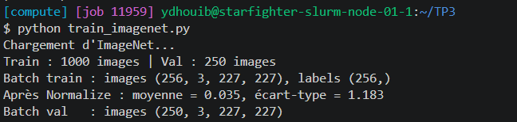

-> Les batchs ont bien la forme attendue : **(256, 3, 227, 227)** pour les images (batch, canaux RGB, hauteur, largeur) et **(256,)** pour les étiquettes. Le batch de validation contient les 250 images du sous-ensemble (`subset_size // 4`).

-> Après `Normalize`, la moyenne du batch vaut **0.035** et l'écart-type **1.183**, donc les données sont bien centrées-réduites (proches de 0 et 1).

### Question 1.1

- **Que se passe-t-il mathématiquement et numériquement lors de la descente de gradient si l'on oublie `transforms.Normalize` ?**

    Sans `Normalize`, les pixels sortent de `ToTensor()` dans $[0, 1]$ : ils sont tous positifs, non centrés, et leur moyenne et leur dispersion diffèrent d'un canal à l'autre. Pour un neurone de la première couche, le gradient d'un poids vaut $\frac{\partial L}{\partial w_i} = \delta \cdot x_i$ : comme tous les $x_i > 0$, tous les poids de ce neurone reçoivent un gradient **du même signe**. Ils ne peuvent donc qu'augmenter ou diminuer ensemble, et la descente avance en zigzag. La surface de perte est aussi plus mal conditionnée (échelles différentes selon les entrées), donc le learning rate est plus difficile à régler : soit la convergence est lente, soit l'entraînement devient instable. Numériquement, les pré-activations de la première couche sont toutes décalées dans le même sens, ce qui peut saturer ou « tuer » des ReLU dès le départ, et un learning rate réglé pour des entrées normalisées n'est plus adapté.

    -> La normalisation centre-réduit chaque canal ($\frac{x - \mu}{\sigma}$), ce qui donne des entrées de moyenne 0 et d'écart-type 1 et une optimisation beaucoup plus stable.

- **Pourquoi les statistiques (moyenne et écart-type) doivent-elles être calculées uniquement sur le jeu d'entraînement ?**

    Pour éviter le *data leakage*: si les statistiques incluaient la validation ou le test, des informations sur ces données « inconnues » entreraient dans l'entraînement, et l'évaluation serait trop optimiste. Les valeurs `IMAGENET_MEAN` / `IMAGENET_STD` utilisées ici sont justement celles calculées sur le train d'ImageNet, puis appliquées telles quelles à la validation.

### Question 1.2

- **Pourquoi utiliser `RandomResizedCrop` et `RandomHorizontalFlip` sur l'entraînement, mais `Resize` + `CenterCrop` sans flip sur le jeu de validation ?**

    Sur l'entraînement, ces transformations font de l'**augmentation de données** : à chaque époque, le modèle voit une version différente de chaque image (autre zone, autre échelle, autre ratio, miroir). Cela augmente artificiellement la taille du dataset, rend le modèle invariant à la position, à l'échelle et à l'orientation gauche/droite de l'objet, et réduit donc le sur-apprentissage.

    Sur la validation, on veut au contraire une mesure **déterministe et reproductible** : la même image doit donner exactement la même entrée à chaque époque, sinon la courbe de validation serait bruitée et on ne pourrait pas comparer les époques (ni les modèles) entre elles. `Resize()` + `CenterCrop()` garde la partie centrale de l'image, où se trouve en général l'objet, à une échelle proche de celle vue en moyenne à l'entraînement.

    -> Aléatoire pour apprendre à généraliser, déterministe pour mesurer.

### Question 1.3

- **Exemple de tâche de classification d'images où l'augmentation par `RandomHorizontalFlip` serait néfaste et fausserait les étiquettes**

    La reconnaissance de **caractères** (lettres manuscrites ou imprimées) : un « b » retourné horizontalement devient un « d », et un « p » devient un « q ». L'image retournée garderait pourtant l'étiquette d'origine : on fabriquerait des exemples faux, et le modèle apprendrait à confondre les deux classes.

    -> Quand l'orientation gauche/droite porte l'information, le flip ne préserve plus l'étiquette : il faut le désactiver et garder seulement des augmentations sans risque (petites translations, petites rotations, variations de luminosité).
---

## Exercice 2 : Étude théorique et implémentation des architectures (MLP vs AlexNet)

> **Note :** J'ai ajouté à la suite du template une fonction `show_architecture()` qui affiche `count_parameters` pour `MLP()` et `AlexNet()`, ainsi que la taille de sortie de chaque couche d'AlexNet pour une image.

### Étape 1 : Implémentation du MLP (Baseline)

#### Question 2.1

- **Calculez à la main le nombre exact de paramètres de ce MLP (en comptant les biais, puis sans les biais). Quelle couche concentre plus de 99% des paramètres ?**

    L'entrée aplatie contient $3 \times 227 \times 227 = 154\,587$ valeurs.

    *   **SANS les biais :**
        *   Couche 1 : $154\,587 \times 256 = 39\,574\,272$ poids
        *   Couche 2 : $256 \times 256 = 65\,536$ poids
        *   Couche 3 : $256 \times 1000 = 256\,000$ poids
        *   **Total = 39 895 808 paramètres**
    *   **AVEC les biais :**
        *   Couche 1 : $39\,574\,272 + 256 = 39\,574\,528$
        *   Couche 2 : $65\,536 + 256 = 65\,792$
        *   Couche 3 : $256\,000 + 1000 = 257\,000$
        *   **Total = 39 897 320 paramètres**

    -> C'est la **première couche** (entrée → 256) qui concentre plus de 99 % (**99.19 %**) des paramètres.

#### Question 2.2

- **Outre ce nombre élevé de paramètres en entrée, quel est le défaut structurel majeur du MLP lorsqu'on lui fournit une image aplatie (flatten) ?**

    En aplatissant l'image, le MLP **perd toute la structure spatiale** : deux pixels voisins deviennent deux entrées indépendantes, comme deux pixels aux coins opposés de l'image. Il n'y a ni **localité** ni **partage des poids** : un motif (un bord, un œil…) appris à une position doit être réappris séparément à chaque autre position. Le MLP n'est donc pas invariant par translation : si l'objet se décale de quelques pixels, l'entrée change complètement pour lui.

    -> C'est ce que corrigent les convolutions : des filtres locaux, partagés sur toute l'image.

### Étape 2 : Analyse et implémentation d'AlexNet

#### Question 2.3

- **Recopiez et complétez l'intégralité de ce tableau en format Markdown dans votre rapport. Pour la colonne Mémoire sortie (KB), calculez la mémoire occupée par les activations de sortie de chaque couche pour une seule image en supposant des flottants 32 bits (4 octets, $1\text{ KB} = 1024\text{ octets}$).**

    Formules utilisées :
    *   Taille de sortie : $H_{out} = \left\lfloor \frac{H_{in} + 2P - K}{S} \right\rfloor + 1$
    *   Paramètres : $C_{out} \times (C_{in} \times K \times K) + C_{out}$ pour une convolution, $n_{in} \times n_{out} + n_{out}$ pour une couche linéaire
    *   Mémoire : $C \times H \times W \times 4$ octets $/ 1024$ (float32)

| Couche | Taille entrée (C, H×W) | Hyperparamètres (Filtres/Neurones, K, S, P) | Taille sortie (C, H×W) | # Paramètres (avec biais) | Mémoire sortie (KB) |
| :--- | :--- | :--- | :--- | ---: | ---: |
| **Conv1** + ReLU | 3, 227×227 | 64, 11×11, S=4, P=2 | 64, 56×56 | 23 296 | 784 |
| **MaxPool1** | 64, 56×56 | 3×3, S=2, P=0 | 64, 27×27 | 0 | 182.25 |
| **Conv2** + ReLU | 64, 27×27 | 192, 5×5, S=1, P=2 | 192, 27×27 | 307 392 | 546.75 |
| **MaxPool2** | 192, 27×27 | 3×3, S=2, P=0 | 192, 13×13 | 0 | 126.75 |
| **Conv3** + ReLU | 192, 13×13 | 384, 3×3, S=1, P=1 | 384, 13×13 | 663 936 | 253.5 |
| **Conv4** + ReLU | 384, 13×13 | 256, 3×3, S=1, P=1 | 256, 13×13 | 884 992 | 169 |
| **Conv5** + ReLU | 256, 13×13 | 256, 3×3, S=1, P=1 | 256, 13×13 | 590 080 | 169 |
| **MaxPool3** | 256, 13×13 | 3×3, S=2, P=0 | 256, 6×6 | 0 | 36 |
| **Flatten** + Dropout | 256, 6×6 | p = 0.5 | 9216 (1D) | 0 | 36 |
| **Linear1** + ReLU + Dropout | 9216 | 4096 neurones (p = 0.5) | 4096 | 37 752 832 | 16 |
| **Linear2** + ReLU | 4096 | 4096 neurones | 4096 | 16 781 312 | 16 |
| **Linear3** (Sortie) | 4096 | 1000 classes | 1000 | 4 097 000 | 3.91 |
| **Total** | | | | **61 100 840** | **≈ 2339** |

Exemple pour Conv1 : $H_{out} = \lfloor \frac{227 + 4 - 11}{4} \rfloor + 1 = 56$ ; paramètres $= 64 \times (3 \times 11 \times 11) + 64 = 23\,296$ ; mémoire $= 64 \times 56 \times 56 \times 4 / 1024 = 784$ KB.

-> La sortie de MaxPool3 est de taille $256 \times 6 \times 6 = 9216$, d'où `nn.Linear(256 * 6 * 6, 4096)` dans le code.

### Output du script train_imagenet_ex2.py

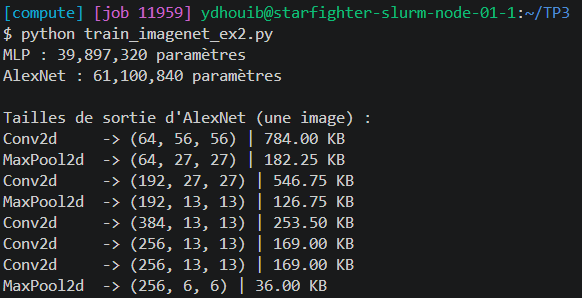

-> `count_parameters` donne **39 897 320** paramètres pour le MLP et **61 100 840** pour AlexNet, et les tailles de sortie de chaque couche correspondent exactement au tableau.

#### Question 2.4

- **Dans AlexNet, où se concentre l'essentiel des paramètres (poids) ? À l'inverse, où se concentre l'essentiel de la mémoire des activations (indispensable à stocker lors du forward pour calculer la backpropagation) ?**

    *   **Paramètres :** dans les **couches entièrement connectées** : 58 631 144 paramètres, soit **96 %** du total. Linear1 seule en représente **61.8 %**, car elle relie les 9216 sorties de MaxPool3 aux 4096 neurones. Les 5 convolutions n'ont que 2 469 696 paramètres (4 %).
    *   **Mémoire des activations :** à l'inverse, dans les **premières couches convolutives**, où les cartes de caractéristiques sont encore grandes. La partie `features` occupe 2267 KB sur 2339 (**97 %**), dont 1331 KB (57 %) pour Conv1 et Conv2 seules.

    -> Les convolutions coûtent en mémoire, les couches denses coûtent en paramètres.

#### Question 2.5

- **Comparez la mémoire totale des activations d'AlexNet (environ $2340\text{ KB}$ par image) avec celle du MLP de l'étape 1. Expliquez ce paradoxe alors que les deux réseaux ont un ordre de grandeur similaire en nombre de paramètres.**

    Pour le MLP, les activations de sortie valent $(256 + 256 + 1000) \times 4 / 1024 \approx$ **5.9 KB** par image, contre **≈ 2339 KB** pour AlexNet, soit environ **400 fois plus**, alors que les deux réseaux ont 40 M et 61 M de paramètres.

    Ce paradoxe vient du **partage des poids** de la convolution : un filtre de quelques centaines de paramètres est appliqué à **toutes les positions** de l'image et produit une sortie pour chacune (Conv1 : $64 \times 56 \times 56 = 200\,704$ valeurs pour seulement 23 296 paramètres). Le MLP fait l'inverse : chaque connexion a son propre poids (39.6 M pour la première couche), mais il compresse immédiatement l'image en 256 valeurs.

    Or ce sont les activations qu'il faut garder pour la rétropropagation, et elles sont multipliées par la taille du batch : avec 256 images, AlexNet stocke environ **585 MB** d'activations de sortie, contre environ **1.5 MB** pour le MLP.

    -> Le nombre de paramètres ne suffit pas pour estimer la mémoire GPU : pour un CNN, ce sont les activations (× batch size) qui dominent.

---

## Exercice 3 : Boucle d'entraînement, Early Stopping et Comparaison rapide

> **Note :** J'ai ajouté à la suite du template la classe `AlexNetDeep` (Étape 2), la branche `"alexnet_deep"` correspondante dans `train_model`, et un bloc dans `if __name__ == "__main__":` qui permet de choisir le modèle (`--model`), la taille du sous-ensemble (`--subset`) et le nombre d'époques (`--epochs`).

### Output du script train_imagenet_ex3.py : MLP, subset_size = 20000, 10 époques

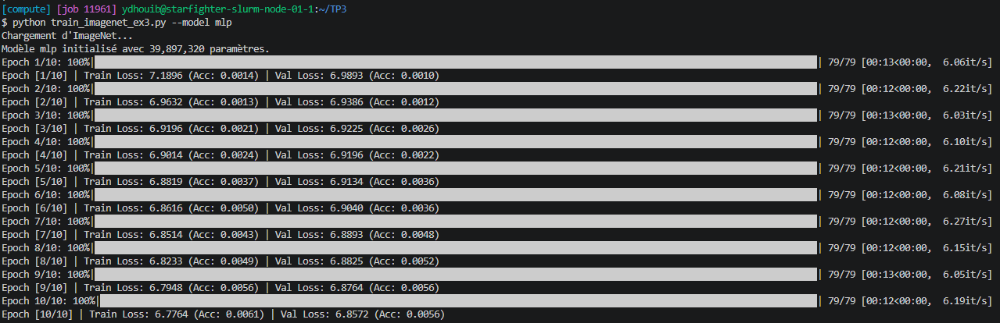

### Output du script train_imagenet_ex3.py : AlexNet, subset_size = 20000, 10 époques

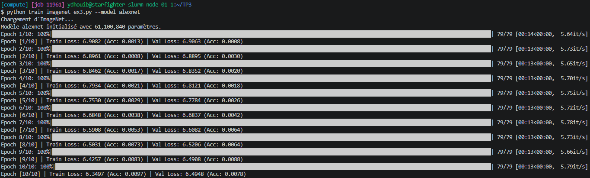

### Question 3.1

- **Quel est le rôle exact de `model.eval()` et `model.train()` vis-à-vis des couches `nn.Dropout` présentes dans AlexNet ? Que se passerait-il si l'on oubliait `model.eval()` pendant l'évaluation ?**

    `model.train()` **active** le Dropout : à chaque passe avant, chaque neurone est mis à zéro avec une probabilité $p = 0.5$, et les neurones restants sont multipliés par $\frac{1}{1-p} = 2$ pour garder la même espérance. `model.eval()` le **désactive** : tous les neurones sont utilisés et la sortie devient déterministe.

    Si on oubliait `model.eval()`, l'évaluation serait faite avec un réseau privé de la moitié des neurones de ses couches denses, et différent à chaque batch. La `val_loss` serait plus élevée, l'accuracy plus faible et les résultats changeraient d'une évaluation à l'autre.

    -> On sous-estimerait la vraie performance du modèle, et l'Early Stopping prendrait ses décisions sur une mesure bruitée.

### Question 3.2

- **Sur un jeu de données à 1000 classes équilibrées comme ImageNet, quelle est la valeur théorique de l'accuracy et de la CrossEntropyLoss ($\ln(1000)$) à l'initialisation (choix purement aléatoire) ? Vos premières époques sont-elles cohérentes avec ces valeurs ?**

    Avec un choix purement aléatoire, chaque classe reçoit la probabilité $\frac{1}{1000}$ :
    *   Accuracy : $\frac{1}{1000} =$ **0.1 %**
    *   CrossEntropyLoss : $-\ln\left(\frac{1}{1000}\right) = \ln(1000) \approx$ **6.9078**

    À la première époque, on obtient :
    *   **AlexNet :** Train Loss = **6.9082** (Acc : **0.0013**), Val Loss = **6.9063** (Acc : **0.0008**)
    *   **MLP :** Train Loss = **7.1896** (Acc : **0.0014**), Val Loss = **6.9893** (Acc : **0.0010**)

    Les accuracies (0.08 % à 0.14 %) sont bien au niveau du hasard, et les losses d'AlexNet sont pratiquement égales à $\ln(1000)$. La Train Loss du MLP est un peu au-dessus (7.19) : c'est une moyenne sur toute la première époque, et pendant les premières itérations, Adam déplace chacun des poids de la première couche d'environ `lr` à chaque pas. Cumulés sur 154 587 entrées par neurone, ces petits déplacements font fortement varier les sorties, ce qui donne probablement des prédictions instables et trop « confiantes », plus coûteuses que $\ln(1000)$. Elle redescend à 6.96 dès l'époque 2.

    -> Les premières époques sont cohérentes avec les valeurs théoriques : les deux modèles partent du hasard.

### Question 3.3

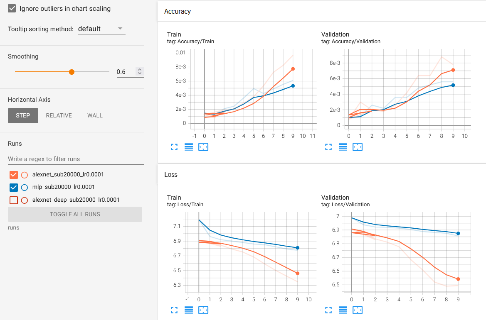

Courbes `Loss/Train`, `Loss/Validation`, `Accuracy/Train` et `Accuracy/Validation` du MLP (bleu) et d'AlexNet (orange). Le lissage TensorBoard est à 0.6.

- **Comparez les courbes TensorBoard (Train/Val Loss et Accuracy) du MLP et d'AlexNet sur ce sous-ensemble de 20 000 images. Lequel apprend le mieux ? Lequel sur-apprend (overfit) le plus vite et pourquoi ?**

    C'est **AlexNet** qui apprend le mieux : après 10 époques, sa Val Loss descend à **6.4948** (Val Acc : **0.78 %**), contre **6.8572** (Val Acc : **0.56 %**) pour le MLP, dont les courbes restent presque plates. Grâce aux convolutions, AlexNet exploite la structure spatiale de l'image, alors que le MLP doit tout apprendre à partir de pixels aplatis.

    C'est aussi **AlexNet** qui commence à sur-apprendre le premier : sa Train Loss continue de baisser (6.4257 → 6.3497 entre les époques 9 et 10) alors que sa Val Loss stagne puis remonte légèrement (6.4908 → 6.4948), et l'écart train/val passe à 0.145 (contre 0.081 pour le MLP). Avec seulement 20 images par classe en moyenne, AlexNet apprend assez vite pour commencer à mémoriser les images d'entraînement. Le MLP, lui, apprend trop lentement pour en arriver là en 10 époques : il est encore en sous-apprentissage.

    -> Sur 20 000 images, le modèle le plus performant est aussi le premier à sur-apprendre, et les deux restent sous 1 % d'accuracy : il faut beaucoup plus de données pour vraiment entraîner ces réseaux.

### Étape 2 : Impact de la profondeur (Modification d'architecture)

### Output du script train_imagenet_ex3.py : AlexNet profond, subset_size = 20000, 10 époques

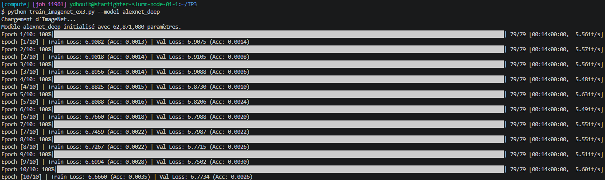

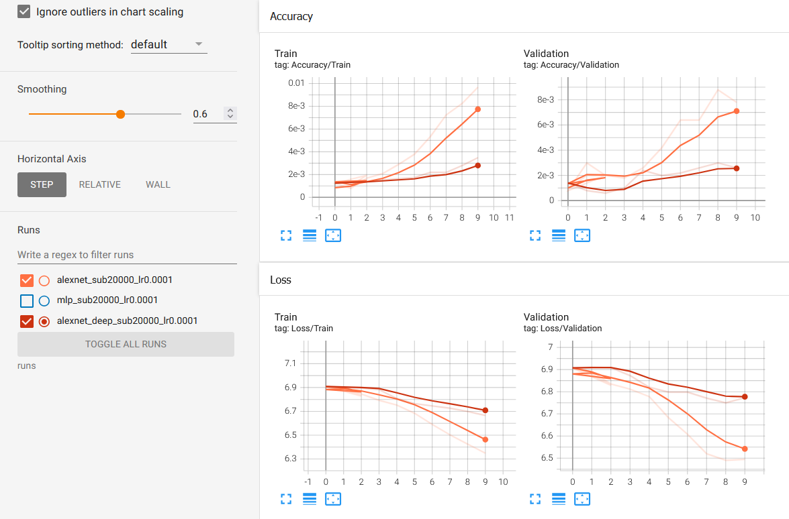

Courbes d'AlexNet (orange) et d'AlexNet profond (rouge foncé). Le lissage TensorBoard est à 0.6.

### Question 3.4

- **Observez les courbes d'entraînement de ce réseau plus profond par rapport à l'AlexNet standard. La dégradation ou la difficulté à démarrer l'apprentissage que vous observez au début relève-t-elle du sur-apprentissage (overfitting) ou du sous-apprentissage (underfitting) ? Comment l'expliquez-vous du point de vue de la propagation du gradient ?**

    Il s'agit de **sous-apprentissage** (*underfitting*) : pendant les 3 premières époques, c'est la `Loss/Train` elle-même qui reste bloquée près de $\ln(1000)$ (**6.9082 → 6.8956**, contre 6.9082 → 6.8462 pour AlexNet), avec une accuracy d'entraînement au niveau du hasard (0.13 % à 0.14 %), et la Val Loss ne bouge pas (≈ 6.91). Le réseau n'arrive même pas à apprendre le jeu d'entraînement. À l'époque 10, il reste loin derrière AlexNet : Train Loss **6.6660** contre 6.3497, Val Loss **6.7734** contre 6.4948. Un sur-apprentissage se traduirait au contraire par une `Loss/Train` qui baisse et une `Loss/Validation` qui remonte.

    Du point de vue du gradient, la rétropropagation multiplie les dérivées locales couche par couche (règle de la chaîne). Avec 3 couches de plus, sans BatchNorm ni connexions résiduelles, le signal s'atténue à chaque couche : le gradient qui arrive aux premières couches devient très petit (*vanishing gradient*). Conv1 à Conv5 sont alors à peine mises à jour, et la sortie reste presque constante.

    -> Plus profond ne veut pas dire meilleur sans précautions : c'est ce que corrigent la BatchNorm et les connexions résiduelles (ResNet).

---

## Exercice 4 : Lancement et analyse d'un entraînement long via sbatch

> **Note :** Dans `run_imagenet.sh`, j'ai ajouté `--account=csc_8607` et `--qos=normal` (obligatoires sur notre cluster) et lancé `train_imagenet_ex4.py`.

### Soumission du job (`sbatch run_imagenet.sh` puis `squeue -u $USER`)

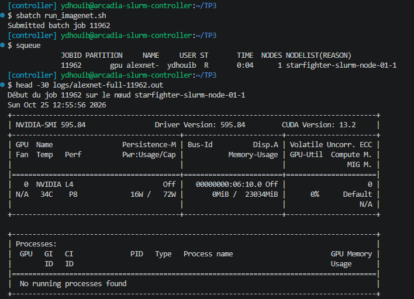

### Durée des époques

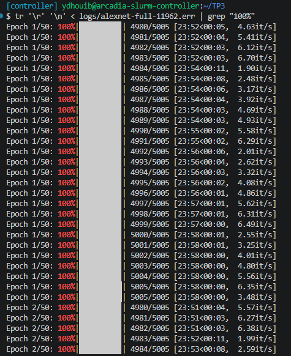

### Question 4.1 : Profilage temporel et matériel

- **Combien de temps (en minutes/secondes) dure exactement une époque complète sur les 1,28 million d'images d'entraînement avec votre GPU ?**

    D'après les barres de progression du fichier `logs/alexnet-full-11962.err`, une époque d'entraînement complète (5005 batchs de 256 images) dure **24 min 00 s** sur le **NVIDIA L4** (entre 23:57 et 24:04 selon les époques), soit **3.47 batchs/s ≈ 890 images/s**. Il faut ajouter **1 min 06 s** pour l'évaluation sur les 50 000 images de validation, donc environ **25 min** par époque au total.

- **À cette vitesse, combien d'heures faudrait-il pour compléter 100 époques sans Early Stopping ?**

    $100 \times 25 \text{ min} \approx 2\,510 \text{ min} \approx$ **42 heures**, soit environ **1.75 jour** de calcul sur un seul GPU. Comme le job est limité à 4 h (environ 9 époques), il faudrait le relancer une dizaine de fois.

    -> Un entraînement complet d'AlexNet sur ImageNet demande presque deux jours de GPU : c'est pour cela qu'on valide d'abord le code sur un petit sous-ensemble.

### Question 4.2 : Analyse de l'entraînement au fil de l'eau

### Output du job (`logs/alexnet-full-11962.out`)

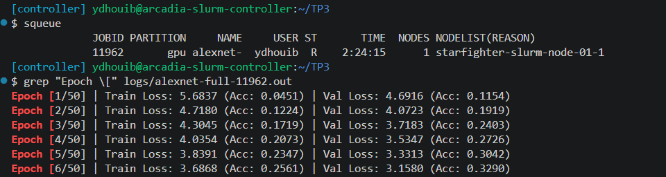

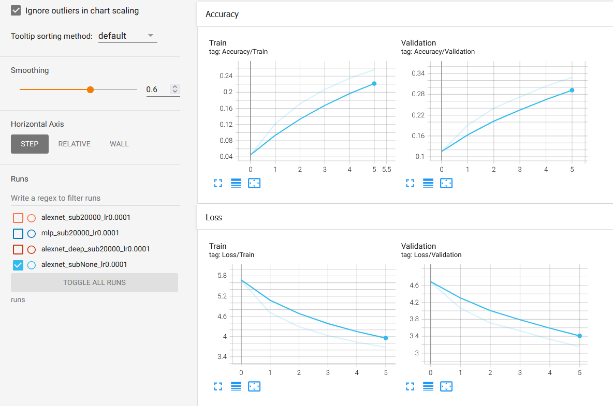

Courbes `Loss/Train`, `Loss/Validation`, `Accuracy/Train` et `Accuracy/Validation` d'AlexNet sur ImageNet complet, après 6 époques (2 h 24 de job). Le lissage TensorBoard est à 0.6.

| Époque | Train Loss | Train Acc | Val Loss | Val Acc |
| :---: | :---: | :---: | :---: | :---: |
| 1 | 5.6837 | 4.51 % | 4.6916 | 11.54 % |
| 2 | 4.7180 | 12.24 % | 4.0723 | 19.19 % |
| 3 | 4.3045 | 17.19 % | 3.7183 | 24.03 % |
| 4 | 4.0354 | 20.73 % | 3.5347 | 27.26 % |
| 5 | 3.8391 | 23.47 % | 3.3313 | 30.42 % |
| 6 | 3.6868 | 25.61 % | 3.1580 | 32.90 % |

- **Comparez l'écart entre Loss/Train et Loss/Validation sur le dataset complet (1,28M d'images + Data Augmentation) avec celui que vous aviez observé à l'exercice 3 sur le petit sous-ensemble de 20 000 images. Pourquoi le sur-apprentissage est-il beaucoup plus faible ici ?**

    Sur le dataset complet, il n'y a **aucun sur-apprentissage** : les deux pertes baissent ensemble à chaque époque, et la Val Loss reste même **inférieure** à la Train Loss (3.1580 contre 3.6868 à l'époque 6, soit un écart de **−0.53**), avec une Val Acc de **32.90 %** contre 25.61 % en train. À l'exercice 3, au contraire, la Val Loss d'AlexNet dépassait la Train Loss de **0.145** à l'époque 10 et commençait à remonter, pour une accuracy inférieure à 1 %.

    La raison principale est la **quantité de données** : on passe de 20 000 images (≈ 20 par classe) à 1,28 million (≈ 1280 par classe), soit 64 fois plus. Avec 61 M de paramètres, AlexNet pouvait commencer à mémoriser 20 000 images, mais pas 1,28 million : il est obligé d'apprendre des motifs qui généralisent. De plus, avec la **Data Augmentation**, le modèle voit une version différente de chaque image à chaque époque, donc il ne revoit presque jamais deux fois la même entrée.

    -> Plus de données (et plus de variété) est la régularisation la plus efficace contre le sur-apprentissage.

### Question 4.3 : Observation surprenante

- **Lors des premières époques, il arrive fréquemment que la perte de validation (Loss/Validation) soit légèrement inférieure (meilleure) à la perte d'entraînement (Loss/Train). Donnez deux raisons techniques liées à notre code (indice : regardez ce qui est actif pendant le train mais désactivé pendant le val) qui expliquent ce phénomène !**

    1. **Le Dropout** : actif pendant l'entraînement (`model.train()`) et désactivé pendant la validation (`model.eval()`). La Train Loss est donc calculée avec un réseau qui n'utilise que la moitié des neurones de ses couches denses, moins performant que le réseau complet utilisé en validation.
    2. **La Data Augmentation** : elle ne s'applique qu'à l'entraînement. `RandomResizedCrop` peut ne garder qu'une petite partie de l'image (jusqu'à 8 % de sa surface) avec un ratio déformé, alors que les images de validation (`Resize` + `CenterCrop`) sont centrées sur l'objet et non déformées, donc plus « faciles ».

    On l'observe ici à chacune des 6 époques : Val Loss **4.6916** contre **5.6837** en train à l'époque 1, et **3.1580** contre **3.6868** à l'époque 6.

    En plus, la Train Loss est une moyenne sur toute l'époque (avec des poids encore mauvais au début), alors que la Val Loss est mesurée à la fin de l'époque, avec les poids déjà améliorés, ce qui explique un tel résultat.

---
---

*Ce TP nous a permis de passer du MLP aux réseaux convolutifs sur un dataset à grande échelle : préparer ImageNet avec augmentation de données, analyser couche par couche les paramètres et la mémoire d'AlexNet, mettre en place l'Early Stopping, observer l'effet de la profondeur sur la propagation du gradient, et lancer un entraînement long en tâche de fond avec Slurm.*

*Fin*