# Compte Rendu — TP4 : Réseaux récurrents et génération de séquences
**Cours :** CSC 8607 — Introduction au Deep Learning  
**Auteur :** Youssef DHOUIB

---

## Exercice 1 : Exploration et Prétraitement des partitions ABC

### Output du script train_music_ex1.py

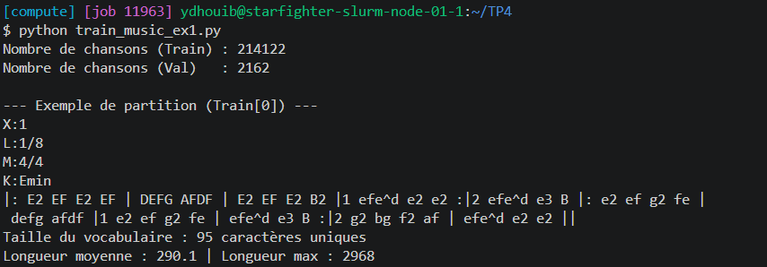

### Étape 1 : Chargement et découverte du jeu de données

### Question 1.1

- **Exécutez ce code et indiquez dans votre rapport le nombre exact de partitions présentes dans `train.json` et dans `validation.json`.**

    *   `train.json` : **214 122** partitions
    *   `validation.json` : **2 162** partitions

    -> Le jeu de validation ne représente qu'environ 1 % du jeu d'entraînement.

### Question 1.2

- **Copiez le texte de la première partition (`train_data[0]["abc notation"]`) et collez-le dans le lecteur interactif ABC Player pour voir la partition et l'écouter. En observant le texte brut, identifiez et expliquez le rôle des métadonnées d'en-tête présentes sur les premières lignes avant le début des notes.**

    ```text
    X:1
    L:1/8
    M:4/4
    K:Emin
    |: E2 EF E2 EF | DEFG AFDF | E2 EF E2 B2 |1 efe^d e2 e2 :|2 efe^d e3 B |: e2 ef g2 fe |
     defg afdf |1 e2 ef g2 fe | efe^d e3 B :|2 g2 bg f2 af | efe^d e2 e2 ||
    ```

    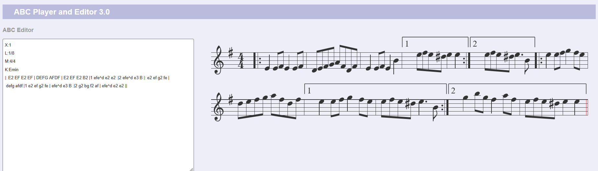

    Les 4 premières lignes, de la forme `Lettre:valeur`, sont l'**en-tête** : elles ne contiennent pas de notes, mais indiquent comment interpréter celles qui suivent.
    *   `X:1` : **numéro de référence** du morceau (toujours la première ligne).
    *   `L:1/8` : **durée de note par défaut**, ici la croche : `E` dure une croche, `E2` une noire, `e3` une noire pointée.
    *   `M:4/4` : **métrique**, 4 temps par mesure : chaque mesure entre deux `|` contient l'équivalent de 8 croches.
    *   `K:Emin` : **tonalité** (mi mineur), d'où le dièse à la clé (fa♯) sur la portée ; c'est toujours la dernière ligne d'en-tête, les notes commencent juste après.

    -> Sans cet en-tête, la même suite de lettres ne pourrait pas être jouée : le lecteur ne connaîtrait ni la durée des notes, ni la mesure, ni la tonalité.

### Étape 2 : Construction du vocabulaire et Padding

### Question 1.3

- **Combien y a-t-il de caractères uniques (`vocab_size`) ? Quelle est la longueur moyenne et la longueur maximale d'une partition dans le jeu d'entraînement ?**

    *   `vocab_size` = **95** caractères uniques
    *   Longueur moyenne : **290.1** caractères
    *   Longueur maximale : **2968** caractères

    -> La longueur maximale est environ 10 fois la longueur moyenne : quelques partitions sont beaucoup plus longues que les autres.

### Question 1.4

- **Pourquoi est-il indispensable d'appliquer `sorted(...)` sur le `set` des caractères uniques avant de créer `char_to_index` ? Que se passerait-il si vous sauvegardiez les poids de votre modèle aujourd'hui et que vous relanciez votre script demain pour générer de la musique sans ce `sorted()` ?**

    Un `set` n'a pas d'ordre garanti : en Python, le hachage des chaînes de caractères est aléatoire à chaque lancement de l'interpréteur (`PYTHONHASHSEED`), donc `list(set(all_text))` peut renvoyer les caractères dans un ordre différent d'une exécution à l'autre. `sorted()` rend l'ordre déterministe : le même caractère reçoit toujours le même indice.

    Sans `sorted()`, le modèle sauvegardé aujourd'hui aurait appris avec une correspondance (par ex. `'A'` → 12) et le script relancé demain en construirait une autre (`'A'` → 47). Les lignes de la matrice d'`Embedding` et les sorties de la couche `fc` ne correspondraient plus aux bons caractères : le modèle lirait une amorce « mélangée » et ses prédictions seraient décodées vers les mauvais caractères, ce qui produirait une suite de caractères sans aucun sens.

    -> Le vocabulaire fait partie du modèle au même titre que ses poids : il doit être reconstruit exactement à l'identique (ou sauvegardé avec les poids).

### Question 1.5

- **Pourquoi avons-nous choisi de tronquer à `SEQ_LENGTH = 500` (environ deux fois la longueur moyenne) plutôt que d'aligner toutes les chansons sur la longueur maximale `max_len` du dataset ? Quel serait l'impact d'un padding jusqu'à `max_len` sur le temps de calcul, la mémoire GPU et l'apprentissage du modèle ?**

    Avec `SEQ_LENGTH = 500`, la plupart des partitions (longueur moyenne **290.1**) tiennent entièrement dans la séquence, et seules les plus longues perdent leur fin. Aligner tout le monde sur `max_len` = **2968**, soit environ 6 fois plus, ferait payer à toutes les partitions le coût de la plus longue :
    *   **Temps de calcul :** un RNN traite la séquence pas à pas, de façon séquentielle : le temps du *forward* et de la BPTT est proportionnel à la longueur, donc environ **6 fois** plus long par batch, essentiellement pour traiter des espaces.
    *   **Mémoire GPU :** pour la BPTT, il faut stocker les activations de chaque pas de temps (taille $\text{batch} \times L \times \text{hidden\_size}$), donc la mémoire croît aussi linéairement avec $L$ et obligerait à réduire fortement le batch.
    *   **Apprentissage :** en moyenne, plus de 90 % des positions ($1 - 290/2968$) seraient du padding. La loss serait dominée par la prédiction triviale « espace → espace », ce qui dilue le signal utile des vraies notes, et des séquences très longues aggravent le *vanishing* / *exploding gradient* pendant la BPTT.

    -> 500 caractères est un compromis : on garde presque toute l'information musicale pour un coût de calcul et de mémoire raisonnable.

---

## Exercice 2 : Dataset PyTorch auto-régressif et Modélisation

> **Note :** J'ai ajouté à la suite du template deux fonctions de vérification : `check_dataset()`, qui affiche les dimensions et le type des tenseurs `x` et `y` d'un batch, et `check_models()`, qui affiche le nombre de paramètres de chaque couche et la structure de `hidden_state` pour le RNN et le LSTM.

### Output du script train_music_ex2.py

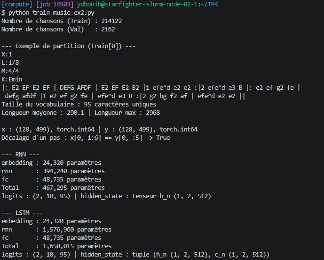

### Étape 1 : Création du `MusicDataset`

### Question 2.1

- **Si l'on fixe `SEQ_LENGTH = 500` et `BATCH_SIZE = 128`, quelles sont les dimensions exactes (*shapes*) des tenseurs `x` et `y` renvoyés par une itération du `DataLoader` ? Pourquoi utilise-t-on le type `torch.long` (entiers 64 bits) plutôt que `torch.float32` pour ces tenseurs ?**

    `x` et `y` ont tous les deux la forme **(128, 499)** : chaque séquence de 500 caractères donne une entrée de 499 caractères (`seq[:-1]`) et une cible de 499 caractères décalée d'un pas (`seq[1:]`). Le dernier batch d'une époque peut être plus petit si le nombre de partitions n'est pas un multiple de 128.

    On utilise **`torch.long`** car ces valeurs sont des **indices de classes**, pas des grandeurs continues :
    *   `nn.Embedding` s'en sert comme numéros de ligne dans sa table : un indice doit être un entier (on ne peut pas lire la ligne 12.7).
    *   `nn.CrossEntropyLoss` attend des cibles de type `long`, qui désignent la classe correcte parmi les `vocab_size` possibles.

    -> La sortie du script le confirme : `x` et `y` sont de forme (128, 499) et de type `torch.int64`, et `y` est bien `x` décalé d'un caractère. L'indice d'un caractère est une étiquette : les calculs en `float32` n'ont de sens qu'après l'Embedding.

### Étape 2 : Architecture récurrente (RNN vs LSTM)

### Question 2.2

- **Calcul théorique des paramètres : Pour `vocab_size = 95`, `embedding_dim = 256` et `hidden_size = 512`, calculez à la main le nombre exact de paramètres de chacune des trois couches (`embedding`, `rnn`, `fc`) lorsque `rnn_type="rnn"`, puis lorsque `rnn_type="lstm"` (attention : dans PyTorch, les couches récurrentes possèdent deux vecteurs de biais $b_{ih}$ et $b_{hh}$ par porte !). Vérifiez votre calcul avec `count_parameters`. Pourquoi le bloc LSTM a-t-il exactement 4 fois plus de paramètres que le bloc RNN ?**

    *   **Embedding :** $95 \times 256 =$ **24 320** paramètres (une ligne de 256 valeurs par caractère, sans biais).
    *   **RNN :** $W_{ih}$ : $512 \times 256 = 131\,072$ ; $W_{hh}$ : $512 \times 512 = 262\,144$ ; $b_{ih}$ et $b_{hh}$ : $512 + 512 = 1\,024$ ; soit **394 240** paramètres.
    *   **LSTM :** les mêmes matrices pour chacune des 4 portes : $4 \times 394\,240 =$ **1 576 960** paramètres.
    *   **fc :** $512 \times 95 + 95 =$ **48 735** paramètres.

    | Couche | `rnn_type="rnn"` | `rnn_type="lstm"` |
    | :--- | ---: | ---: |
    | `embedding` | 24 320 | 24 320 |
    | `rnn` | 394 240 | 1 576 960 |
    | `fc` | 48 735 | 48 735 |
    | **Total** | **467 295** | **1 650 015** |

    -> `count_parameters` donne exactement les mêmes valeurs : **467 295** paramètres pour le RNN et **1 650 015** pour le LSTM, avec 394 240 et 1 576 960 paramètres pour le bloc récurrent.

    Le LSTM a exactement 4 fois plus de paramètres car il calcule **4 transformations** de même forme à chaque pas de temps, au lieu d'une seule pour le RNN : la porte d'entrée $i_t$, la porte d'oubli $f_t$, le candidat $g_t$ et la porte de sortie $o_t$. Chacune possède ses propres $W_{ih}$, $W_{hh}$, $b_{ih}$ et $b_{hh}$, de mêmes dimensions que ceux du RNN (PyTorch les empile en matrices de $4 \times 512$ lignes).

### Question 2.3

- **Pourquoi est-il bien plus pertinent d'utiliser une couche `nn.Embedding` en entrée plutôt que de passer directement l'indice scalaire $i \in \{0, \dots, V-1\}$ dans une couche linéaire $1 \to$ `embedding_dim` ?**

    Avec une couche linéaire $1 \to d$, la représentation d'un caractère serait $i \cdot w + b$ : tous les caractères seraient sur **une même droite** de l'espace, et ne différeraient que par un facteur d'échelle proportionnel à leur indice. Le modèle supposerait aussi un ordre et des distances qui n'existent pas : le caractère d'indice 34 serait « deux fois plus loin » de 0 que celui d'indice 17, alors que l'indice vient seulement du tri alphabétique.

    `nn.Embedding` donne à chaque caractère **son propre vecteur appris** de dimension 256, indépendant des autres (c'est équivalent à un one-hot multiplié par une matrice, mais sans faire la multiplication). Le modèle peut ainsi rapprocher des caractères au rôle proche, par exemple les notes `A`–`G` entre elles ou les barres de mesure `|` et `:`.

    -> L'Embedding apprend une vraie représentation de chaque caractère, au lieu d'imposer une structure arbitraire liée à son indice.

### Question 2.4

- **Quelle est la différence de structure entre la variable `hidden_state` retournée par `self.rnn` lorsque l'on utilise `nn.RNN` par rapport à `nn.LSTM` ? Expliquez le rôle respectif des deux états retournés par le LSTM.**

    *   Avec **`nn.RNN`**, `hidden_state` est **un seul tenseur** $h_n$ de forme `(num_layers, batch_size, hidden_size)`, ici `(1, batch_size, 512)`.
    *   Avec **`nn.LSTM`**, c'est un **tuple** $(h_n, c_n)$ de deux tenseurs de même forme `(1, batch_size, 512)`.

    Les deux états du LSTM ont des rôles différents :
    *   $h_t$ (**hidden state**) est la sortie du LSTM à chaque pas : c'est lui que reçoit la couche `fc` pour prédire le caractère suivant, et il sert d'entrée aux portes au pas suivant. Il représente l'information utile à court terme : $h_t = o_t \odot \tanh(c_t)$.
    *   $c_t$ (**cell state**) est la **mémoire à long terme** : il n'est jamais envoyé à la sortie, et il est mis à jour de façon additive par les portes, $c_t = f_t \odot c_{t-1} + i_t \odot g_t$. La porte d'oubli décide ce qu'on garde du passé, la porte d'entrée ce qu'on ajoute.

    -> Pendant la génération, il faut transmettre les deux états d'un pas au suivant : le tuple $(h, c)$ pour le LSTM, et seulement $h$ pour le RNN.

---

## Exercice 3 : Entraînement, Dynamique des Gradients et Comparaison RNN vs LSTM

> **Note :** J'ai ajouté à la suite du template un bloc `if __name__ == "__main__":` qui permet de choisir le type de réseau (`--rnn_type`) et le seuil de clipping (`--max_grad_norm`) pour lancer les 3 runs.

### Output du script train_music_ex3.py : Run 1 (RNN, sans clipping)

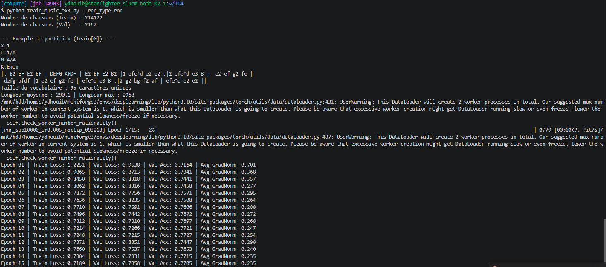

### Output du script train_music_ex3.py : Run 2 (RNN, `max_grad_norm=1.0`)

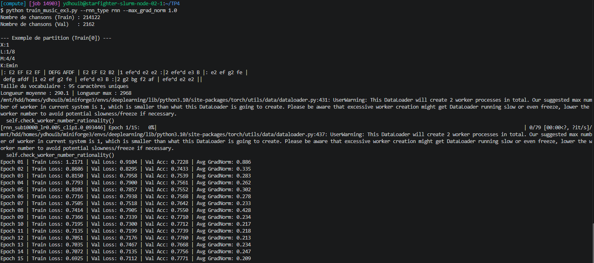

### Output du script train_music_ex3.py : Run 3 (LSTM, `max_grad_norm=1.0`)

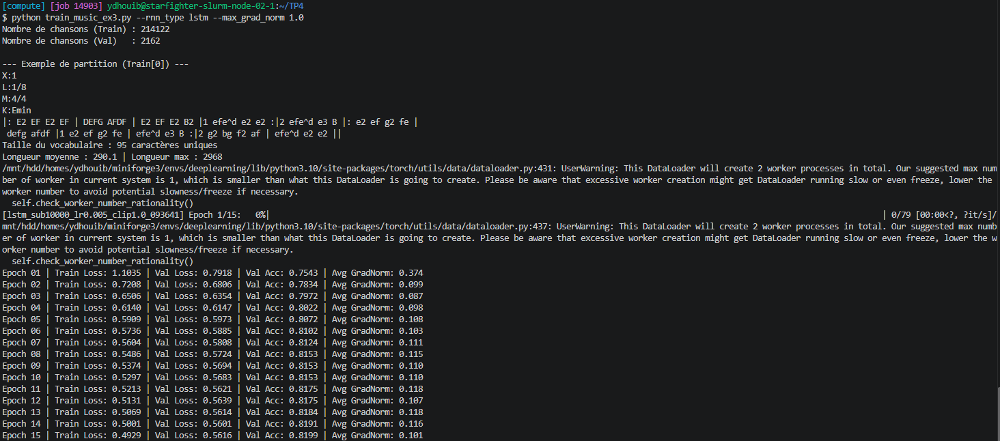

### Question 3.1

- **Manipulation des tenseurs : Pourquoi doit-on écrire `logits.reshape(-1, vocab_size)` et `y.reshape(-1)` avant d'appeler `loss_fn` ? Que représente la valeur numérique de la dimension obtenue à la place du `-1` ?**

    `nn.CrossEntropyLoss` attend des logits de forme **(N, C)** (une ligne de `vocab_size` scores par exemple) et des cibles de forme **(N,)** (un indice de classe par exemple). Or le modèle renvoie des logits de forme `(batch_size, seq_len, vocab_size)` et des cibles `(batch_size, seq_len)`. On aplatit donc les deux premières dimensions pour que chaque position de chaque séquence devienne un exemple de classification indépendant : prédire le caractère suivant parmi 95.

    La dimension obtenue à la place du `-1` est le **nombre total de caractères à prédire dans le batch** : $\text{batch\_size} \times \text{seq\_len} = 128 \times 499 =$ **63 872** (moins pour le dernier batch d'une époque).

    -> La loss calculée est donc la moyenne de l'erreur sur les 63 872 prédictions du batch.

### Question 3.2

- **Ordre des opérations : Pourquoi la fonction `clip_grad_norm_` doit-elle impérativement être appelée après `loss.backward()` mais avant `optimizer.step()` ?**

    *   **Après `loss.backward()`** : c'est `backward()` qui calcule les gradients et les stocke dans `p.grad`. Avant, il n'y a rien à mesurer ni à couper (les gradients sont à `None` après `zero_grad(set_to_none=True)`).
    *   **Avant `optimizer.step()`** : c'est `step()` qui utilise `p.grad` pour mettre à jour les poids. `clip_grad_norm_` modifie les gradients en place : si la norme globale $\|g\|$ dépasse `max_norm`, tous les gradients sont multipliés par $\frac{\text{max\_norm}}{\|g\|}$. Appelé après `step()`, le clipping arriverait trop tard : le pas, éventuellement énorme, aurait déjà été appliqué aux poids.

    -> Le clipping doit se placer entre le calcul des gradients et leur utilisation.

### Question 3.3

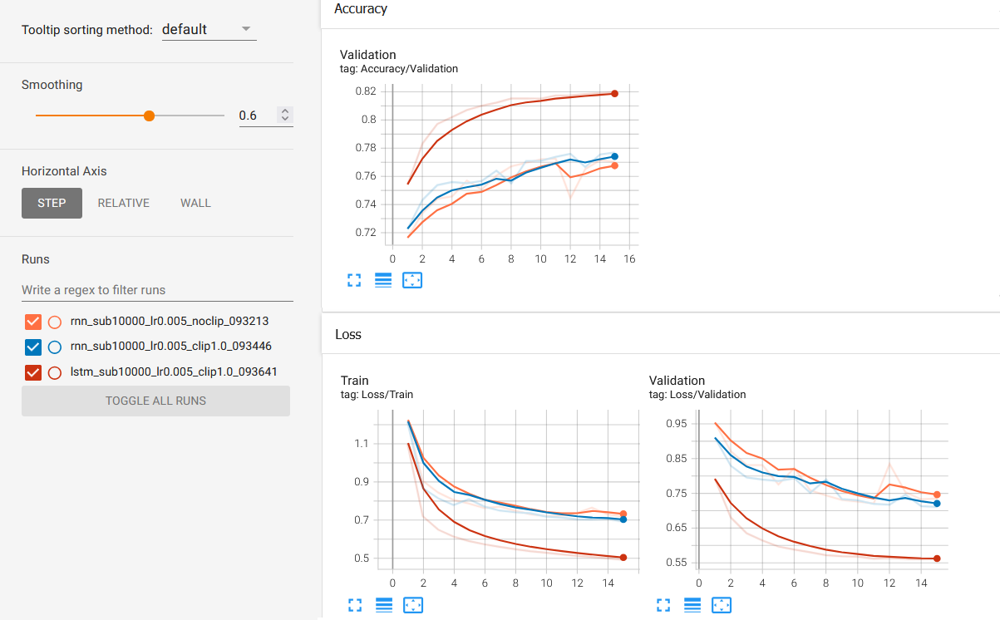

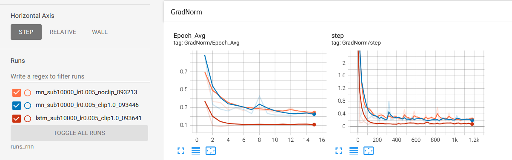

Courbes `Loss/Validation` et `Accuracy/Validation` (`ex3_4.png`) et `GradNorm/Epoch_Avg` et `GradNorm/step` (`ex3_5.png`) des 3 runs : Run 1 (orange), Run 2 (bleu) et Run 3 (rouge). Le lissage TensorBoard est à 0.6.

- **Comparez l'évolution de la norme des gradients et la stabilité de la perte entre le Run 1 et le Run 2. Quel problème théorique du RNN simple le *gradient clipping* corrige-t-il ici ?**

    Pour les deux RNN, la norme des gradients est très élevée au tout début (au-dessus de 2 sur `GradNorm/step`), puis retombe autour de 0.2–0.4, avec des **pics isolés** (par exemple vers le pas 320 pour le Run 2 et vers le pas 800 pour le Run 1). La valeur enregistrée est la norme *avant* clipping, car `clip_grad_norm_` renvoie la norme d'origine : les courbes des deux runs se ressemblent donc, et l'effet du clipping se voit surtout sur la perte.

    *   **Run 1 (sans clipping) :** la perte est instable. À l'époque 12, la Val Loss remonte brusquement de **0.7215 à 0.8351** (Val Acc de 77.27 % à 74.47 %), et la Train Loss remonte aussi pendant 2 époques (0.7248 → 0.7660) : un pas trop grand a dégradé les poids, et la Val Loss ne retrouve plus son meilleur niveau (0.7215) avant la fin. Résultat final : Val Loss **0.7358**, Val Acc **77.05 %**.
    *   **Run 2 (clipping à 1.0) :** la descente est plus régulière, les remontées sont plus petites (0.7518 → 0.7905 à l'époque 8) et la meilleure valeur est atteinte à la dernière époque : Val Loss **0.7112**, Val Acc **77.71 %**.

    Le clipping corrige l'**explosion du gradient** (*exploding gradient*). Pendant la BPTT, le gradient traverse 499 fois la même matrice $W_{hh}$ : $\frac{\partial h_T}{\partial h_t} = \prod_{k=t+1}^{T} \text{diag}(\tanh'(\cdot))\, W_{hh}$. Si la plus grande valeur singulière de $W_{hh}$ dépasse 1, ce produit peut croître exponentiellement et un seul batch peut produire un pas énorme qui détruit l'apprentissage. Le clipping garde la direction du gradient mais limite sa norme à 1.0.

    -> Ici, l'explosion reste modérée (pas de `NaN`) et les normes sont le plus souvent sous 1, donc le clipping n'agit qu'au début et sur les pics : il suffit pourtant à éviter le décrochage du Run 1 et donne une meilleure perte finale.

- **Comparez les performances (vitesse de convergence, Loss et Accuracy de validation finales) entre le Run 2 (RNN) et le Run 3 (LSTM). Expliquez mathématiquement (à l'aide des portes et de l'équation de mise à jour du *cell state* $c_t$ vue en cours) pourquoi le LSTM parvient à capturer des dépendances plus longues dans la partition musicale.**

    Le **LSTM** (Run 3) est nettement meilleur :
    *   **Vitesse de convergence :** dès l'époque 2, sa Val Loss (**0.6806**) est déjà plus basse que celle du RNN à la fin de l'entraînement (0.7112).
    *   **Résultats finaux (époque 15) :** Val Loss **0.5616** contre 0.7112, et Val Acc **81.99 %** contre 77.71 % pour le RNN.
    *   **Gradients :** sa norme moyenne se stabilise autour de **0.10** dès l'époque 3, contre 0.2–0.4 pour le RNN, et sans pic.

    Dans le LSTM, le *cell state* est mis à jour de façon **additive** :
    $$c_t = f_t \odot c_{t-1} + i_t \odot g_t$$
    avec $f_t = \sigma(W_f [h_{t-1}, x_t] + b_f)$ la porte d'oubli, $i_t$ la porte d'entrée et $g_t = \tanh(\dots)$ le candidat. Le gradient le long du *cell state* vaut donc $\frac{\partial c_t}{\partial c_{t-1}} = \text{diag}(f_t)$ (en négligeant la dépendance indirecte via $h_{t-1}$) : il n'y a ni multiplication répétée par $W_{hh}$, ni dérivée de $\tanh$ à chaque pas. Tant que la porte d'oubli reste proche de 1, le gradient traverse des centaines de pas de temps presque sans s'atténuer. Dans le RNN, $h_t = \tanh(W_{ih} x_t + W_{hh} h_{t-1} + b)$ multiplie le gradient par $\tanh'(\cdot)\, W_{hh}$ à chaque pas, ce qui le fait disparaître (*vanishing*) bien avant d'atteindre le début de la partition.

    -> Le LSTM peut ainsi relier un caractère à l'en-tête (`M:`, `K:`) ou au début d'une reprise `|: … :|` situés des centaines de caractères plus tôt.

### Question 3.4

- **Réflexion sur la métrique : Sachant qu'une partition de 250 caractères a été paddée jusqu'à 500 caractères avec des espaces `' '`, pourquoi l'`Accuracy/Validation` affichée est-elle artificiellement optimiste quant à la capacité réelle du modèle à prédire des notes de musique ? Quelle modification simple de `nn.CrossEntropyLoss` permettrait de ne pas compter le padding dans la perte ?**

    Pour une partition de 250 caractères, la moitié des positions sont du padding. Or prédire « espace » après une suite d'espaces est **trivial** : le modèle l'apprend très vite et obtient presque 100 % de bonnes réponses sur ces positions. L'accuracy mélange ces prédictions faciles avec celles des vraies notes, donc elle reflète surtout la quantité de padding. Avec une longueur moyenne de 290.1 caractères (train), au moins 42 % des positions sont du padding en moyenne ($1 - 290.1/500$).

    La modification simple est l'argument **`ignore_index`** : `nn.CrossEntropyLoss(ignore_index=char_to_index[" "])`. Les positions dont la cible vaut cet indice ne comptent ni dans la loss, ni dans le gradient. Il faudrait appliquer le même masque à l'accuracy.

    -> Attention : l'espace est aussi un vrai caractère de la notation ABC (il sépare les groupes de notes). Pour ne masquer que le padding, il vaudrait mieux utiliser un caractère de padding dédié, absent des partitions, et passer son indice à `ignore_index`.

---

## Exercice 4 : Génération musicale, Température et Job Slurm

> **Note :** J'ai ajouté à la suite du template un bloc `if __name__ == "__main__":` qui entraîne le LSTM (`hidden_size=1024`, `subset_size=50000`, `max_grad_norm=1.0`, `num_epochs=30`), recharge le meilleur modèle `best_lstm.pth` et génère les 3 partitions (T = 0.2, 0.8 et 2.0). Dans `run_music.sh`, j'ai ajouté `--account=csc_8607` et `--qos=normal`, et remplacé l'activation par `mamba activate deeplearning`.

### Étape 1 : Implémentation de la génération avec propagation de l'état caché

### Question 4.1

- **Efficacité algorithmique : Dans la boucle `for` ci-dessus, nous passons uniquement le dernier caractère généré `[[next_index]]` de taille `(1, 1)` tout en fournissant `hidden_state` au modèle. Si, au lieu de conserver `hidden_state`, nous avions concaténé toute la séquence générée depuis le début et repassé la séquence entière à `model(full_seq, None)` à chaque itération, quelle aurait été la complexité temporelle totale pour générer N caractères ? Quelle est la complexité avec notre méthode ?**

    *   **En repassant toute la séquence :** à l'itération $k$, le modèle retraite les $P + k$ caractères (amorce de longueur $P$ + $k$ caractères déjà générés), alors que l'état caché final serait exactement le même. Le coût total est $\sum_{k=1}^{N} (P + k) = NP + \frac{N(N+1)}{2}$, soit **$O(N^2)$**.
    *   **Avec notre méthode :** l'amorce est lue une seule fois ($O(P)$), puis chaque nouveau caractère coûte un seul pas de temps du LSTM. Le coût total est **$O(P + N)$**, donc linéaire en $N$.

    -> Pour $N = 300$ et $P = 33$, cela fait environ 55 000 pas de temps calculés au lieu de 333. L'état caché résume déjà tout le passé : il est inutile de le recalculer.

### Question 4.2

- **Rôle mathématique de la température T : Que devient la distribution de probabilité $\text{softmax}(z_t / T)$ lorsque $T \to 0^+$ ? À quelle stratégie de décodage cela correspond-il ?**

    Diviser les logits par un petit $T$ **amplifie les écarts** entre eux : $\frac{e^{z_c/T}}{\sum_{c'} e^{z_{c'}/T}} = \frac{1}{\sum_{c'} e^{(z_{c'} - z_c)/T}}$. Pour le caractère de logit maximal, tous les termes $z_{c'} - z_c$ sont négatifs (sauf $c' = c$), donc ils tendent vers 0 et sa probabilité tend vers **1** ; pour les autres, au moins un terme tend vers $+\infty$ et leur probabilité tend vers 0. La distribution devient un **one-hot sur l'argmax**.

    -> Cela correspond au **décodage glouton** (*greedy decoding*) : on choisit toujours le caractère le plus probable.

- **Que devient cette distribution lorsque $T \to +\infty$ ?**

    $z_t / T \to 0$ pour tous les caractères, donc $\text{softmax}(z_t / T) \to \frac{1}{V}$ : la distribution devient **uniforme** sur les 95 caractères du vocabulaire.

    -> Le modèle n'a plus aucune influence : on tire chaque caractère au hasard.

### Question 4.3

- **Écoute et analyse qualitative : À l'aide de votre meilleur modèle LSTM sauvegardé (ou après avoir lancé un entraînement plus complet à l'étape 2 ci-dessous), générez 3 partitions de 300 caractères à partir de l'amorce `"X:1\nT:Irish Reel\nM:4/4\nL:1/8\nK:D\n"` avec trois températures : T = 0.2 (basse température), T = 0.8 (température modérée), T = 2.0 (haute température). Copiez les 3 partitions générées dans votre rapport et testez-les sur ABC Player. Commentez la validité syntaxique (respect des barres de mesure, des notes ABC) et la richesse musicale (répétitions vs chaos) de chacune des trois générations.**

    Les 3 partitions sont générées par le meilleur LSTM du job `sbatch` (`hidden_size=1024`, 50 000 partitions), sauvegardé à l'époque 7 : Val Loss **0.4969**, Val Acc **83.85 %**.

    **T = 0.2 :**

    ```text
    X:1
    T:Irish Reel
    M:4/4
    L:1/8
    K:D
     d2 df e2 d2 | B2 B2 B2 A2 | d2 d2 d2 A2 | B2 A2 F2 A2 | B2 B2 B2 A2 |
     F2 E2 E4 | d2 d2 B2 A2 | F2 F2 F2 E2 | D2 F2 A2 B2 | A2 F2 E2 D2 | D2 F2 A2 B2 | A2 F2 E4 |
     D2 F2 A2 A2 | B2 A2 F2 A2 | B2 A2 F2 E2 | D2 F2 E4 | D2 F2 A2 B2 | A4 F4 | A2 F2 E2 D2 |
     F4 E4 | D2 F2 A2 B2 | A4 F4 | A2 F2 E2 D2
    ```

    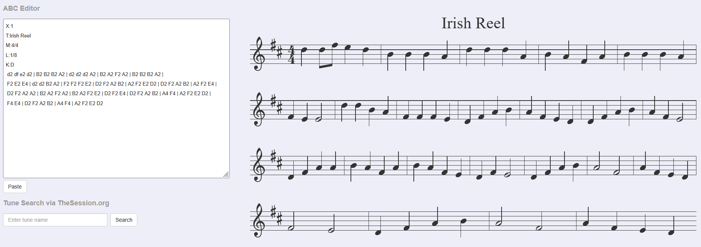

    *   **Syntaxe : parfaite.** Chaque mesure contient exactement 8 croches (`B2 B2 B2 A2`, `F2 E2 E4`, `A4 F4`), toutes les notes appartiennent à la gamme de ré majeur, et ABC Player l'affiche sans erreur. Seule la fin manque (pas de `||`), car la génération s'arrête à 300 caractères.
    *   **Musique : très répétitive.** Presque uniquement des noires (`X2`), aucune reprise `|: :|`, et la même formule `D2 F2 A2 B2 | A2 F2 E2 D2` revient 4 fois. Le modèle reste bloqué dans les suites les plus probables : la mélodie est correcte mais monotone.

    **T = 0.8 :**

    ```text
    X:1
    T:Irish Reel
    M:4/4
    L:1/8
    K:D
     A3 B AF A2 | F3 G AG FE | F3 c BA FA | dc Bc Ad d2 | A3 B A2 Bc |1
     d2 f2 d2 cd :|2 B2 G2 G2 FG || B2 Bc B2 Bd | c2 Bc A2 dc | B3 A BA FB | A2 F2 F2 ED | F2 Bc B2 AG |
     F3 G F2 AG | F3 F GA FG |1 A2 D2 D2 Bc :|2 F2 G2 A4 ||
    ```

    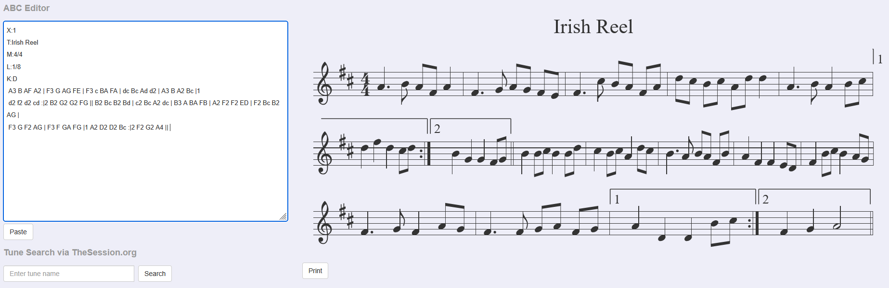

    *   **Syntaxe : correcte.** Les mesures font bien 8 croches (`A3 B AF A2`, `F3 G AG FE`), et la structure typique d'un reel est respectée : deux parties avec fins alternatives `|1 … :|2`, séparées par `||` et terminées par `||`. ABC Player affiche les deux voltes 1 et 2 sans erreur.
    *   **Musique : la plus riche.** Les rythmes sont variés (notes pointées `A3 B`, croches liées `AG FE`), la mélodie monte et descend dans la tonalité de ré majeur, et la partition ressemble vraiment à un air irlandais.

    **T = 2.0 :**

    ```text
    X:1
    T:Irish Reel
    M:4/4
    L:1/8
    K:D
    |: D2 GA EC D>G |: ga (3fdf ge gd |"A" Fdfa ge | fa
    "Am/A" Ae(fe) |"D" (fejDE)g)  fg | 1(2(f/g/)d- df/e rHecA-)}AAA|q(ublie\!"e7)" B2-"G" !>!!bfC2B]/)sc{/BB4)BB)} BG/B d.B/k |
    [Q:BY}"D"{FRqFa]2 A,/>uBc/ (d<.b)"F7" Ed e/.a"Bb" |1,2bvD7u(c]:2-"g" bagb/a<z2/{/gh8) z{/G{ccczic[QBB^A/ ||[M:0/8]{FGE]"A#
    ```

    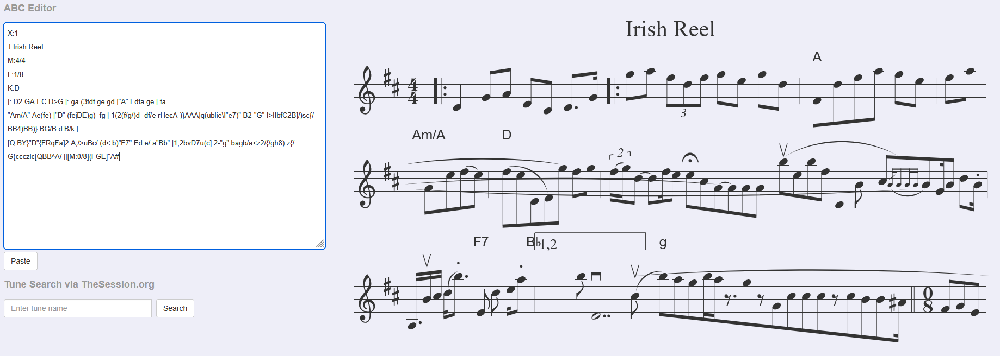

    *   **Syntaxe : cassée.** Le début ressemble encore à de l'ABC, mais on trouve vite des accords entre guillemets sans logique (`"Am/A"`, `"F7"`, `"Bb"`, `"A#"`), des parenthèses et accolades non fermées, des caractères absents de la notation (`q(ublie`, `k`, `rHecA`) et des champs d'en-tête invalides au milieu des notes (`[Q:BY}`, `[M:0/8]`). ABC Player affiche quand même quelque chose, mais avec une métrique en 0/8 et des mesures de longueur quelconque.
    *   **Musique : le chaos.** Il n'y a plus ni mélodie ni rythme : la distribution est tellement aplatie que les caractères rares du vocabulaire (`"`, `{`, `[`, `!`) sont tirés presque aussi souvent que les notes.

    -> La température règle le compromis : à T = 0.2, la syntaxe est parfaite mais tout se répète ; à T = 2.0, tout est varié mais plus rien n'a de sens ; **T = 0.8** donne le meilleur équilibre, avec une partition à la fois valide et musicale.

### Étape 2 : Entraînement à plus grande échelle via `sbatch`

### Output du job (`logs/music-lstm-14948.out`)

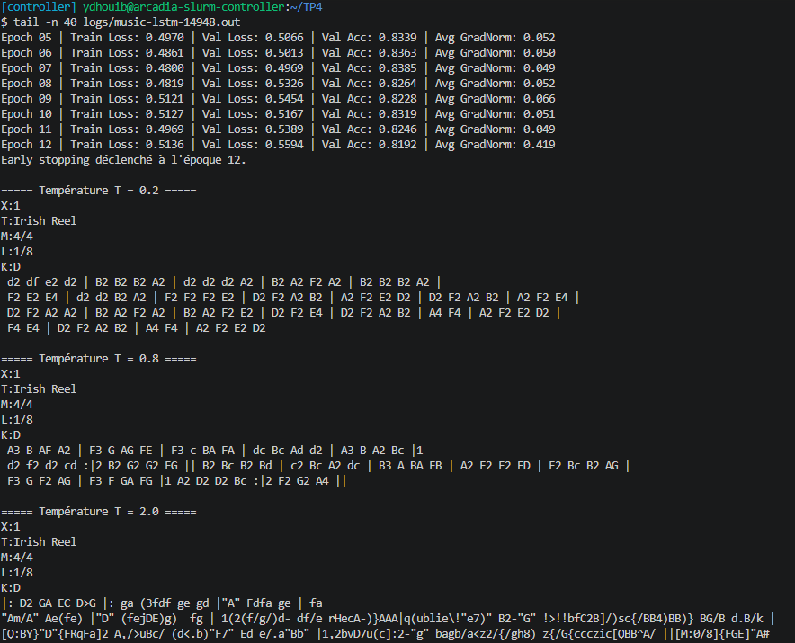

-> L'entraînement s'arrête par Early Stopping à l'époque **12** (bien avant les 30 époques et la limite de 2 h). La meilleure Val Loss est atteinte à l'époque **7** : **0.4969** (Val Acc **83.85 %**), mieux que le LSTM de l'exercice 3 (0.5616, 81.99 %) grâce au modèle plus large et aux 5 fois plus de données. Après l'époque 7, la Train Loss remonte elle aussi (0.4800 → 0.5121 à l'époque 9) : c'est plutôt une instabilité de l'optimisation (learning rate de 5e-3) qu'un sur-apprentissage. La norme moyenne des gradients est très élevée à la première époque (**10.384**), d'où l'intérêt du clipping, puis reste autour de 0.05.

### Question 4.4 (Bonus) : Augmentation de données musicales

- **En musique, transposer une mélodie d'un ou plusieurs demi-tons (ou d'une tonalité à une autre) conserve sa structure musicale tout en modifiant les caractères de notes et l'en-tête `K:`. Expliquez dans votre rapport comment vous pourriez implémenter une telle augmentation de données sur le format ABC et pourquoi cela réduirait le sur-apprentissage.**

    **Implémentation :** dans `MusicDataset.__getitem__`, avant la vectorisation, on tirerait au hasard un décalage de $k$ demi-tons (par exemple $k \in [-5, +6]$) et on transposerait la partition :
    1.  **En-tête `K:`** : décaler la tonique de $k$ demi-tons en gardant le mode (`K:D` + 2 → `K:E`, `K:Emin` + 3 → `K:Gmin`).
    2.  **Notes** : convertir chaque note en hauteur absolue (lettre `A`–`G`/`a`–`g`, octave donnée par la casse et les `'` / `,`, altérations `^`, `_`, `=` et celles de la tonalité), ajouter $k$ demi-tons, puis la réécrire en ABC dans la nouvelle tonalité.
    3.  Ne pas toucher au reste : durées (`2`, `/2`), barres de mesure, reprises et autres lignes d'en-tête (`M:`, `L:`).

    En pratique, une bibliothèque comme `music21` sait déjà lire, transposer et réécrire une partition ABC, ce qui évite d'écrire ce traitement à la main.

    **Effet sur le sur-apprentissage :** chaque partition peut produire jusqu'à 12 versions différentes qui ont la même structure musicale (mêmes intervalles, même rythme). Le modèle ne peut plus mémoriser les suites exactes de caractères de chaque morceau : il est obligé d'apprendre des motifs relatifs (intervalles, formules rythmiques, structure des reprises) valables dans toutes les tonalités.

    -> C'est l'équivalent musical du `RandomHorizontalFlip` pour les images : une transformation qui préserve le « sens » de la donnée et multiplie artificiellement la taille du dataset.

---
---

*Ce TP nous a permis de passer des réseaux convolutifs aux réseaux récurrents : préparer des séquences de caractères (vocabulaire, padding, décalage auto-régressif), comparer un RNN et un LSTM, observer la dynamique des gradients pendant la BPTT et l'effet du gradient clipping, puis générer de la musique au format ABC en contrôlant le compromis diversité/cohérence avec la température.*

*Fin*