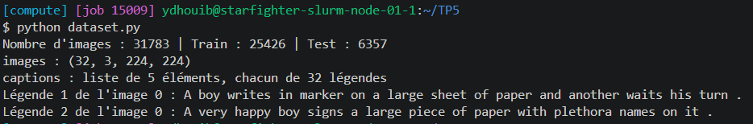
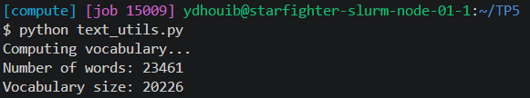
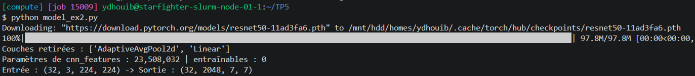
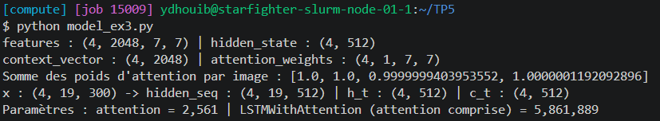
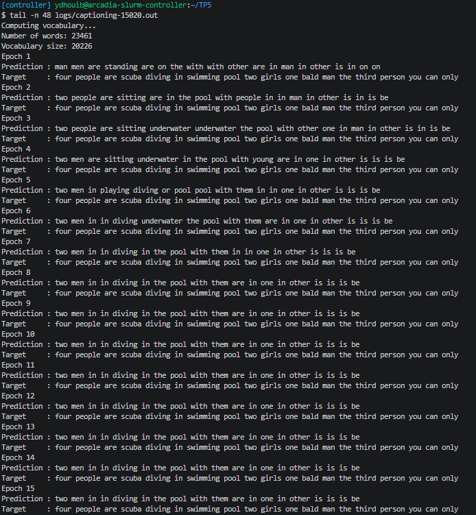
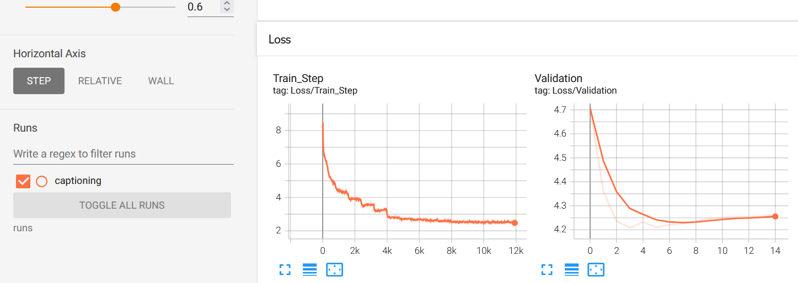
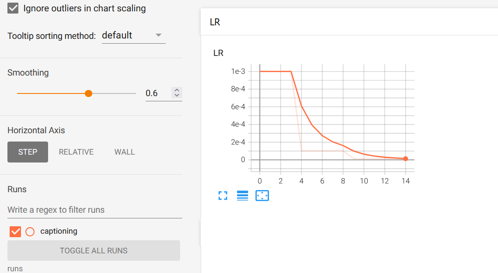

# Compte Rendu — TP5 : Image Captioning avec RNN et Attention sur ResNet
**Cours :** CSC 8607 — Introduction au Deep Learning  
**Auteur :** Youssef DHOUIB

---

## Exercice 1 : Chargement des données et Embeddings

> **Note :** J'ai ajouté à la suite du template de `dataset.py` une fonction `check_data()` qui affiche la taille des ensembles Train/Test et la structure d'un batch (images et légendes).

### Output du script dataset.py



-> Le dataset contient **31 783** images, séparées en **25 426** pour le Train (80 %) et **6 357** pour le Test (20 %). Un batch d'images a bien la forme **(32, 3, 224, 224)**. Chaque image a 5 légendes : le `DataLoader` renvoie donc une liste de 5 éléments, chacun contenant une légende par image du batch (d'où `captions[0]` dans la boucle d'entraînement, qui prend la première légende de chaque image).

### Question 1.a

- **Pourquoi doit-on redimensionner explicitement toutes les images à une taille fixe de (224, 224) avant de les passer dans le réseau, plutôt que de garder leur résolution d'origine ?**

    *   **Pour former des batchs :** les images de Flickr30k ont toutes des tailles différentes. Or un batch est un seul tenseur de forme `(32, 3, H, W)` : le `DataLoader` empile les images, ce qui n'est possible que si elles ont exactement la même taille.
    *   **Pour respecter le ResNet pré-entraîné :** ResNet50 a été entraîné sur ImageNet en 224×224. Ses filtres ont appris à reconnaître des objets à cette échelle, et une entrée de 224×224 donne en sortie une carte de caractéristiques de **7×7** (le ResNet divise la résolution par 32), soit exactement les 49 régions utilisées par le module d'attention.
    *   **Pour le coût de calcul :** le temps et la mémoire d'un CNN croissent avec le nombre de pixels. Des images de taille fixe et réduite gardent un coût prévisible et raisonnable pour chaque batch.

    -> `Resize((224, 224))` déforme un peu les images qui ne sont pas carrées, mais c'est le prix à payer pour pouvoir les grouper en batch et réutiliser directement le ResNet pré-entraîné.

### Output du script text_utils.py



-> Les légendes contiennent **23 461** mots différents, et le vocabulaire du modèle en garde **20 226** (`Vocabulary size`) : les mots présents dans Word2Vec (environ 86 %), plus le mot d'indice 0 (le premier mot du fichier Word2Vec), utilisé comme début de phrase et padding. Les mots absents de Word2Vec sont ignorés par `tokenize`. Chaque mot est représenté par un vecteur Word2Vec de dimension **300**.

---

## Exercice 2 : Extraction de caractéristiques et Transfer Learning

> **Note :** J'ai ajouté à la suite du template de `model_ex2.py` une fonction `check_cnn()` qui affiche les couches retirées, le nombre de paramètres gelés et la forme de sortie de `cnn_features` pour un batch de 32 images.

### Output du script model_ex2.py



-> On retire bien les deux dernières couches (`AdaptiveAvgPool2d` et `Linear`). `cnn_features` contient **23 508 032** paramètres, dont **0** entraînable : tous les poids du ResNet sont gelés. Pour une entrée (32, 3, 224, 224), la sortie a bien la forme **(32, 2048, 7, 7)**.

### Question 2.1

- **Pourquoi est-il crucial de geler (`requires_grad = False`) les poids du ResNet dans ce TP ? Donnez au moins deux raisons (une matérielle et une algorithmique).**

    *   **Raison matérielle :** le ResNet contient 23.5 M de paramètres. Gelés, ils n'ont ni gradient à calculer et stocker, ni état d'Adam (2 valeurs par paramètre) à garder en mémoire, et la rétropropagation s'arrête à la sortie du CNN : PyTorch n'a pas besoin de conserver les activations internes du ResNet pour le *backward*. On économise donc beaucoup de **mémoire GPU** et de **temps de calcul** à chaque batch, ce qui permet de garder des batchs de 32 images.
    *   **Raison algorithmique :** le ResNet a appris sur ImageNet (1.2 M d'images) des caractéristiques visuelles générales (bords, textures, objets) qui sont déjà utiles pour décrire une image. Notre Train ne contient que 25 426 images : réentraîner 23.5 M de paramètres dessus provoquerait du **sur-apprentissage**. De plus, au début de l'entraînement, l'attention et le LSTM sont initialisés au hasard et produisent des gradients bruités qui **détruiraient** les caractéristiques pré-entraînées (*catastrophic forgetting*).

    -> Le ResNet sert d'extracteur de caractéristiques fixe : seule la partie texte (attention + LSTM) apprend, sur des entrées visuelles stables.

### Question 2.2

- **Si vous passez un tenseur image de forme (32, 3, 224, 224) (batch_size, channels, H, W) dans `cnn_features`, quelle sera la dimension (shape) exacte du tenseur de sortie ?**

    La sortie a la forme **(32, 2048, 7, 7)** :
    *   **32** : la taille du batch ne change pas ;
    *   **2048** : le nombre de canaux en sortie du dernier bloc de ResNet50 (`layer4`) ;
    *   **7 × 7** : le ResNet divise la résolution par 32 (convolution initiale de stride 2, max-pooling, puis 3 étages de stride 2), donc $224 / 32 = 7$.

    -> Chaque image est décrite par une grille de 7 × 7 = **49 régions**, chacune représentée par un vecteur de 2048 caractéristiques : c'est sur ces 49 régions que travaillera le module d'attention.

---

## Exercice 3 : Module d'Attention et LSTM Personnalisé

> **Note :** Les codes de l'énoncé utilisent `torch.cat`, `torch.sum` et `torch.zeros`, mais `model.py` n'importe que `torch.nn` : j'ai ajouté `import torch` pour que le script s'exécute. J'ai aussi ajouté à la suite du template une fonction `check_attention()` qui vérifie les dimensions du module d'attention et du LSTM sur des tenseurs aléatoires.

### Output du script model_ex3.py



-> Pour un batch de 4 images et un état caché de taille 512, le module d'attention renvoie un `context_vector` de forme **(4, 2048)** et des poids de forme **(4, 1, 7, 7)** dont la somme vaut bien **1** pour chaque image (softmax sur les 49 régions). Le LSTM renvoie un état caché par mot : `hidden_seq` de forme **(4, 19, 512)**.

### Question 3.a

- **Expliquez en une phrase à quoi correspond conceptuellement la variable `context_vector` renvoyée par ce module. Quel problème structurel du réseau "Seq2Seq de base" cela résout-il ?**

    `context_vector` est la **moyenne pondérée des 49 vecteurs de régions de l'image**, où chaque poids indique à quel point la région est utile pour prédire le mot suivant, compte tenu de ce que le LSTM a déjà généré (son état caché $h_t$) : c'est « la partie de l'image que le modèle regarde » à ce pas de temps.

    $$\text{context} = \sum_{i=1}^{49} \alpha_i \, \text{features}_i \quad \text{avec} \quad \sum_{i=1}^{49} \alpha_i = 1$$

    Cela résout le **goulot d'étranglement** du Seq2Seq de base : l'encodeur y résume toute l'entrée en **un seul vecteur de taille fixe**, calculé une fois et identique pour tous les mots générés. Toute l'information de l'image doit tenir dans ce vecteur, et le décodeur ne peut plus revenir chercher un détail. Avec l'attention, le décodeur recalcule un contexte différent à chaque mot et accède directement aux 49 régions : il peut regarder le chien pour écrire « dog », puis l'herbe pour écrire « grass ».

    -> L'attention remplace un résumé unique et figé par un accès dynamique à toute la carte de caractéristiques.

### Question 3.b

Le LSTM est écrit à la main pour pouvoir recalculer le contexte d'attention à chaque pas de temps, avant le calcul des portes. Les équations complétées sont :
*   $i_t = \sigma(W_i \cdot [\text{context}_t, x_t, h_{t-1}] + b_i)$, $f_t = \sigma(\dots)$, $o_t = \sigma(\dots)$ : les portes, entre 0 et 1 (`torch.sigmoid`) ;
*   $g_t = \tanh(W_c \cdot [\text{context}_t, x_t, h_{t-1}] + b_c)$ : le candidat, entre −1 et 1 (`torch.tanh`) ;
*   $c_t = f_t \odot c_{t-1} + i_t \odot g_t$ et $h_t = o_t \odot \tanh(c_t)$.

-> Chaque porte reçoit 300 (mot) + 512 (état caché) + 2048 (contexte) = **2860** entrées, soit $4 \times (2860 \times 512 + 512) =$ 5 859 328 paramètres pour les 4 portes, plus 2 561 pour la couche d'attention : **5 861 889** au total, ce que confirme `check_attention()`.

---

## Exercice 4 : Modèle Global et Boucle d'Entraînement

> **Note :** Dans `train.py`, j'ai écrit les imports et l'initialisation donnés en commentaire par l'énoncé (`ImageCaptioningModel` avec `lstm_hidden_dim=512`, Adam, `CrossEntropyLoss(ignore_index=0)`, `StepLR`, `SummaryWriter`), et ajouté `writer.close()` à la fin. L'entraînement est lancé sur Slurm avec le script `run_train.sh`.

### Output du job (`logs/captioning-15020.out`)



### Courbes TensorBoard





Courbes `Loss/Train_Step` et `Loss/Validation` (`ex4_2.png`), et `LR` (`ex4_3.png`). Le lissage TensorBoard est à 0.6.

| Époque | LR | Train Loss (moyenne de l'époque) | Val Loss |
| :---: | :---: | :---: | :---: |
| 1 | 1e-3 | 5.543 | 4.7063 |
| 4 | 1e-3 | 3.544 | **4.2070** (minimum) |
| 5 | 1e-3 | 3.232 | 4.2320 |
| 6 | 1e-4 | 2.796 | 4.2102 |
| 10 | 1e-4 | 2.589 | 4.2462 |
| 11 | 1e-5 | 2.535 | 4.2510 |
| 15 | 1e-5 | 2.515 | 4.2615 |

La Train Loss est la moyenne des valeurs de `Loss/Train_Step` sur l'époque, lue dans le fichier TensorBoard. La courbe `LR` est enregistrée après `scheduler.step()` : le point d'abscisse $k$ donne donc le lr de l'époque suivante, d'où la chute visible aux abscisses 4 et 9 (avec le lissage à 0.6, la courbe foncée semble décroître progressivement alors que le lr est divisé d'un coup par 10, comme le montre la courbe claire).

### Question 4.1

- **Observez les phrases générées (Predictions) à l'époque 1 comparées à l'époque 10. Que remarquez-vous sur la syntaxe et la cohérence de la légende produite ? S'améliore-t-elle ?**

    La légende affichée est toujours celle de la même image (la dernière du Test, car `test_loader` n'est pas mélangé) :

    ```text
    Target     : four people are scuba diving in swimming pool two girls one bald man the third person you can only
    Epoch 1    : man men are standing are on the with with other are in man in other is in on on
    Epoch 10   : two men in in diving in the pool with them are in one in other is is is be
    ```

    *   **Époque 1 :** le modèle ne produit que les mots les plus fréquents des légendes (`man`, `men`, `are`, `the`, `with`, `in`), avec des répétitions (`with with`, `on on`) et sans aucun lien avec l'image : rien n'évoque l'eau ou la plongée. Il a appris la distribution des mots, pas encore à regarder l'image.
    *   **Époque 10 :** la légende décrit maintenant **la bonne scène** : « two men … diving in the pool » contient le sujet (des personnes), l'action (`diving`) et le lieu (`pool`), qui viennent forcément de l'image. Le début de la phrase est grammaticalement correct (« diving in the pool with them »). Le nombre de personnes (`two` au lieu de `four`) et `men` au lieu de `people` restent approximatifs.
    *   **Limite :** la fin de la phrase reste dégénérée (« in one in other is is is be »), car la suite de la légende cible (« two girls one bald man the third person… ») est inhabituelle et difficile à prédire. De plus, la prédiction ne change plus du tout à partir de l'époque 8 : avec un lr de 1e-4 puis 1e-5, le modèle n'évolue presque plus.

    -> Oui, la légende s'améliore nettement : on passe d'une suite de mots fréquents sans rapport avec l'image à une phrase qui décrit la scène, même si la syntaxe reste imparfaite en fin de phrase.

    Remarque : la prédiction est obtenue en *teacher forcing* (le modèle reçoit à chaque pas le vrai mot précédent de la légende) et le mot d'indice 0 (`</s>`) sert de padding : la fin de la ligne après la phrase n'est pas à interpréter.

### Question 4.2

- **Analysez l'impact du planificateur de taux d'apprentissage (StepLR). Que se passerait-il lors des dernières époques si on gardait le lr=0.001 constant au lieu de le réduire (decay) ? Pourquoi la décroissance du LR est-elle particulièrement pertinente avec des optimiseurs basés sur le momentum ou la RMSProp (comme Adam) en fin d'entraînement ?**

    Avec `StepLR(step_size=5, gamma=0.1)`, le learning rate est divisé par 10 toutes les 5 époques : **1e-3** pour les époques 1 à 5, **1e-4** pour 6 à 10, puis **1e-5** pour 11 à 15.

    Sur nos courbes :
    *   **Passage à 1e-4 (époque 6) :** c'est la plus forte baisse de la Train Loss de tout l'entraînement, de **3.232 à 2.796** en moyenne (marche visible vers le pas 4 000 sur `Loss/Train_Step`), et la courbe devient moins bruitée (écart-type des points de 0.049 à 0.037). La Val Loss redescend aussi un peu, de 4.2320 à 4.2102.
    *   **Passage à 1e-5 (époque 11) :** la Train Loss ne baisse plus que très peu (2.589 → 2.535, puis 2.515 à l'époque 15) : le modèle est figé, ce que confirment les prédictions identiques des dernières époques.
    *   **Sur-apprentissage :** la Val Loss atteint son minimum dès l'époque **4** (**4.2070**), puis remonte lentement jusqu'à **4.2615** pendant que la Train Loss continue de baisser (écart final de 1.75). Le modèle mémorise les légendes du Train : chaque image est toujours associée à la même légende (`captions[0]`), d'où les petites marches de la Train Loss au début de chaque époque, quand il revoit les mêmes paires. La baisse du lr ralentit cette dérive mais ne l'empêche pas.

    Si on gardait **lr = 0.001 constant**, le modèle s'approcherait du minimum puis **oscillerait autour** sans s'y poser : chaque mini-batch donne un gradient bruité, et un pas de taille fixe le fait rebondir d'un côté à l'autre de la vallée. La loss stagnerait avec beaucoup de bruit au lieu de continuer à descendre.

    Avec **Adam**, la mise à jour vaut $\Delta\theta = -\,\text{lr} \cdot \frac{\hat{m}_t}{\sqrt{\hat{v}_t} + \epsilon}$ : le gradient est divisé par sa propre amplitude (terme RMSProp $\sqrt{\hat{v}_t}$), donc chaque paramètre bouge d'environ **lr** à chaque pas, **même quand le gradient devient petit** près du minimum. Contrairement à la SGD simple, les pas ne diminuent pas d'eux-mêmes en fin d'entraînement. Le momentum $\hat{m}_t$ ajoute de l'inertie, ce qui peut faire dépasser le minimum. Réduire le lr est donc le seul moyen de rendre les pas assez petits pour converger finement.

    -> Un grand lr au début pour avancer vite, puis un petit lr à la fin pour affiner sans osciller.

---
---

*Ce TP nous a permis d'assembler un modèle multimodal complet : charger des images et des légendes, réutiliser un ResNet50 pré-entraîné et gelé comme extracteur de caractéristiques, implémenter à la main un module d'attention spatiale et un LSTM qui l'intègre à chaque pas de temps, puis entraîner l'ensemble avec des embeddings Word2Vec et un learning rate décroissant.*

*Fin*