# Compte Rendu — TP6 : Accélérer un ResNet
**Cours :** CSC 8607 — Introduction au Deep Learning  
**Auteur :** Youssef DHOUIB

---

## Exercice 0 : Mise en place

> **Note :** Dans `tp6_env.sh`, j'ai remplacé l'activation par `mamba activate deeplearning`, et dans `ex0.sh`, j'ai ajouté `--account=csc_8607`. Comme `check_env.py` importe `common.py`, j'ai créé `common.py` dès cet exercice.

### Output du job (`logs/tp6-ex0-54601.out`)

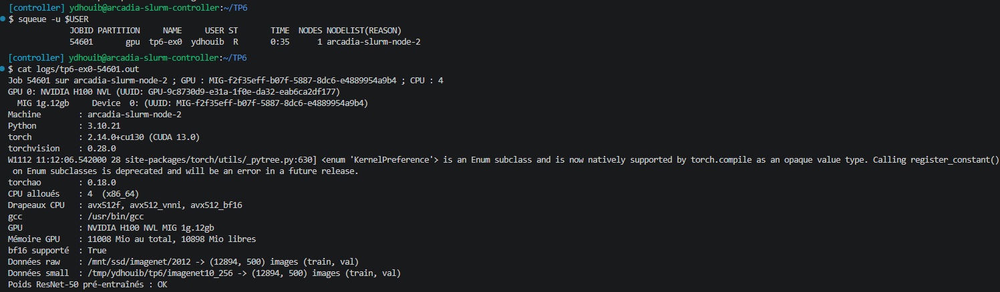

### Question 0.1

- **Recopiez la sortie de check_env.py : nom du GPU, mémoire totale, nombre de CPU alloués, drapeaux CPU, versions.**

    ```text
    Machine        : arcadia-slurm-node-2
    Python         : 3.10.21
    torch          : 2.14.0+cu130 (CUDA 13.0)
    torchvision    : 0.28.0
    torchao        : 0.18.0
    CPU alloués    : 4  (x86_64)
    Drapeaux CPU   : avx512f, avx512_vnni, avx512_bf16
    gcc            : /usr/bin/gcc
    GPU            : NVIDIA H100 NVL MIG 1g.12gb
    Mémoire GPU    : 11008 Mio au total, 10898 Mio libres
    bf16 supporté  : True
    Données raw    : /mnt/ssd/imagenet/2012 -> (12894, 500) images (train, val)
    Données small  : /tmp/ydhouib/tp6/imagenet10_256 -> (12894, 500) images (train, val)
    Poids ResNet-50 pré-entraînés : OK
    ```

    Le GPU est une instance **MIG 1g.12gb** d'un H100 NVL, avec **11 008 Mio** de mémoire. Le job dispose de **4 CPU**, qui ont les instructions `avx512_vnni` et `avx512_bf16`, mais pas d'AMX.

### Question 0.2

- **Vous disposez de 4 CPU pour alimenter un septième de H100. Quelle conséquence anticipez-vous pour le chargement des images ?**

    On s'attend à ce que **le chargement des images devienne le goulot d'étranglement**.

    Pour chaque image, le CPU doit lire le fichier, décoder le JPEG et appliquer les augmentations. Avec 4 CPU, on n'a que **3 workers**, car le processus principal garde un cœur pour lancer les calculs sur le GPU. Même un septième de H100 risque de calculer plus vite que 3 cœurs ne décodent les images, surtout avec les JPEG d'origine.

    -> Le GPU risque d'attendre les données : c'est pour cela que le TP prévoit une copie redimensionnée des images et des données synthétiques.

---

## Exercice 1 : Mesure de référence

> **Note :** Comme `bench.py` est complété en deux temps (exercices 1 et 3), j'ai nommé cette version `bench_ex1.py`. Dans `ex1.sh`, j'ai ajouté `--account=csc_8607` et appelé `bench_ex1.py`.

### Output du job (`logs/tp6-ex1-54611.out`)

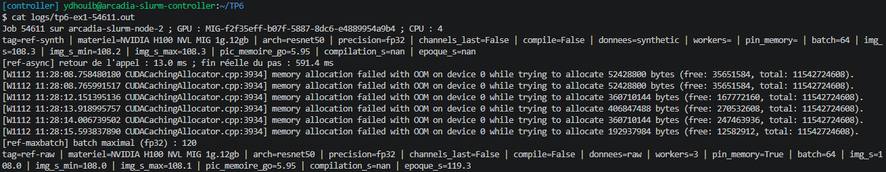

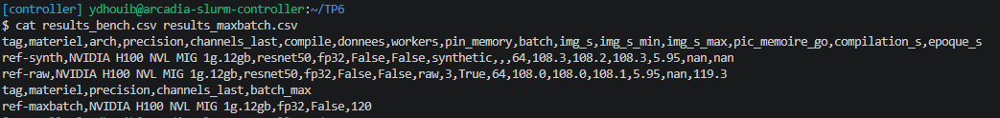

### Question 1.1

- **Donnez, pour ref-synth et ref-raw, le débit (images/s) et le pic de mémoire, et pour ref-raw le temps d'une époque.**

    | Mesure | Débit (images/s) | Pic mémoire (Go) | Temps d'une époque |
    | :--- | :---: | :---: | :---: |
    | `ref-synth` | **108.3** | 5.95 | — |
    | `ref-raw` | **108.0** | 5.95 | **119.3 s** |

    Les mesures sont faites en fp32 sur le MIG 1g.12gb, avec un batch de 64.

### Question 1.2

- **Estimez le pic mémoire de ref-synth avec la méthode du cours. Le modèle à 10 classes a 23,5 M paramètres ; comptez environ 84 Mo d'activations par image en fp32 (estimation du cours). Comparez à la mesure et expliquez l'écart.**

    Avec AdamW en fp32, chaque paramètre coûte 16 octets : poids, gradient et deux moments d'Adam.
    *   Mémoire statique : $23.5 \text{ M} \times 16 \text{ o} = 376$ Mo
    *   Activations : $64 \times 84 \text{ Mo} = 5\,376$ Mo
    *   **Total estimé ≈ 5.75 Go**

    La mesure donne **5.95 Go**, soit seulement 3.5 % de plus. L'estimation ne compte que les activations gardées pour le backward : au moment du pic s'y ajoutent les gradients des activations, les espaces de travail de cuDNN et les tenseurs temporaires d'AdamW.

    -> Les activations représentent 93 % de la mémoire : c'est le batch, et non le nombre de paramètres, qui fixe la mémoire d'un CNN.

### Question 1.3

- **Que montre ref-async ? Pourquoi un chronométrage sans torch.cuda.synchronize() est-il faux ?**

    `ref-async` montre que **l'appel rend la main avant la fin du calcul sur le GPU** : le pas dure **13.0 ms** au retour de l'appel, mais **591.4 ms** jusqu'à sa fin réelle.

    Le CPU ne fait que placer les noyaux CUDA dans une file d'attente, puis continue pendant que le GPU les exécute. Sans `torch.cuda.synchronize()`, on chronomètre seulement le lancement des noyaux : on aurait mesuré environ 4 900 images/s au lieu de 108.

### Question 1.4

- **Quel est le batch maximal en fp32 (results_maxbatch.csv) ? Le cours annonçait « de l'ordre de 120 ». Commentez.**

    Le batch maximal est de **120 images**, ce qui correspond bien à l'annonce du cours.

    Le coût réel d'une image est de $\frac{5.95 - 0.38}{64} \approx 87$ Mo. Avec les 11.54 Go du MIG, on peut donc mettre au plus $\frac{11.54 - 0.38}{0.087} \approx 128$ images, moins ce qu'occupe le contexte CUDA. La recherche avance par pas de 8 : 120 passe et 128 échoue.

### Question 1.5

- **Comparez le débit de ref-raw à celui de ref-synth. Que pouvez-vous déjà en conclure ?**

    Les deux débits sont **identiques** : 108.0 images/s avec les vraies images contre 108.3 images/s en données synthétiques.

    Contrairement à ce qu'on anticipait à l'exercice 0, les 3 workers suivent le rythme du GPU : en fp32 sur un MIG, **le goulot est le calcul**, et non le chargement.

    NB : un de mes jobs (54758) a été placé sur un H100 NVL entier. On y obtient 715.0 images/s en données synthétiques et 698.9 images/s avec les JPEG d'origine, avec une époque de 18.8 s. Ces mesures servent de référence aux exercices 2 et 3, qui ont aussi tourné sur un H100 entier.

---

## Exercice 2 : Chargement des données et profilage

> **Note :** Dans `ex2.sh`, j'ai ajouté `--account=csc_8607` et appelé `bench_ex1.py`.

### Output du job (`logs/tp6-ex2-54866.out`)

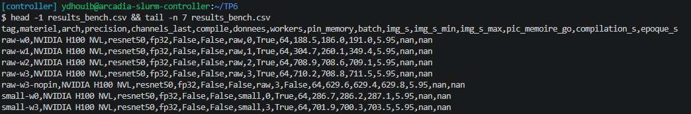

Ce job a été placé sur un **H100 NVL entier**. On compare donc ses débits à `ref-synth` mesuré sur le même GPU, soit **715.0 images/s**.

### Question 2.1

- **Présentez dans un tableau le débit pour raw-w0 à raw-w3, raw-w3-nopin, small-w0 et small-w3.**

    | Configuration | Images | Workers | `pin_memory` | Débit (images/s) |
    | :--- | :--- | :---: | :---: | :---: |
    | `raw-w0` | JPEG d'origine | 0 | oui | 188.5 |
    | `raw-w1` | JPEG d'origine | 1 | oui | 304.7 |
    | `raw-w2` | JPEG d'origine | 2 | oui | 708.9 |
    | `raw-w3` | JPEG d'origine | 3 | oui | **710.2** |
    | `raw-w3-nopin` | JPEG d'origine | 3 | non | 629.6 |
    | `small-w0` | copie 256 px | 0 | oui | 286.7 |
    | `small-w3` | copie 256 px | 3 | oui | 701.9 |

### Question 2.2

- **Comment évolue le débit avec le nombre de workers ? Pourquoi ne peut-on pas dépasser 3 workers utiles avec --cpus-per-task=4 ?**

    Le débit **augmente avec le nombre de workers, puis plafonne au débit du GPU** : de 188.5 images/s sans worker, il passe à 304.7 avec 1 worker, puis à 710.2 avec 3 workers, presque les 715.0 images/s du GPU seul.

    Chaque worker est un processus qui occupe un cœur, et le processus principal en garde un pour la boucle d'entraînement. Avec **4 cœurs**, on a donc au plus **3 workers utiles** : un 4e worker partagerait un cœur et ne décoderait pas plus d'images.

### Question 2.3

- **Quel est l'effet de pin_memory ? Rappelez son rôle.**

    Sans `pin_memory`, le débit baisse de **11 %**, de 710.2 à 629.6 images/s.

    `pin_memory` place les batchs dans de la **mémoire hôte non paginée**. Le GPU peut alors la lire directement, et la copie vers le GPU devient asynchrone avec `non_blocking=True`, ce qui la recouvre avec le calcul. Sinon, CUDA doit d'abord recopier le batch dans un tampon intermédiaire, et la copie bloque le processus principal.

### Question 2.4

- **Pourquoi la copie redimensionnée (small) se charge-t-elle plus vite ? Le modèle voit-il des images différentes ?**

    La copie `small` se charge plus vite parce que **ses images sont plus petites** : le CPU décode moins de pixels, et le décodage JPEG est l'étape la plus coûteuse. Sans worker, on passe de 188.5 à 286.7 images/s.

    Le modèle voit **presque les mêmes images**, puisque `RandomResizedCrop(224)` ramène de toute façon chaque image à 224 × 224 px. Seuls les petits recadrages sont un peu plus flous, car ils sont agrandis depuis une image de 256 px.

### Question 2.5

- **Estimez le temps de décodage d'une image, $t_d$, pour raw et pour small. Avec 0 worker, le processus principal décode puis calcule : $1/D_{w0} \approx t_d + 1/D_{synth}$, où $D$ désigne un débit en images/s. Combien d'images par seconde un worker peut-il fournir ? À partir de quel débit du GPU 3 workers ne suffiront-ils plus ?**

    On isole $t_d$ dans la formule, avec $D_{synth} = 715.0$ images/s :
    *   **raw :** $t_d \approx \frac{1}{188.5} - \frac{1}{715.0} \approx$ **3.91 ms**, soit 256 images/s par worker
    *   **small :** $t_d \approx \frac{1}{286.7} - \frac{1}{715.0} \approx$ **2.09 ms**, soit 479 images/s par worker

    Avec 3 workers, on dispose de $\frac{3}{t_d}$ images/s : ils ne suffiront plus dès que le GPU dépassera **environ 770 images/s avec raw** et **1 440 images/s avec small**.

    NB : `raw-w2` dépasse les 512 images/s prévues pour 2 workers, car le débit est calculé sur la médiane des pas. Les workers livrent leurs batchs presque en même temps, donc un pas sur deux trouve son batch déjà prêt, et la médiane ne voit pas l'attente.

    -> Avec raw, le GPU en fp32 est déjà proche de la limite des 3 workers : dès qu'on accélérera le calcul, il faudra la copie `small`.

### Question 2.6

- **Insérez une capture de la trace raw-w3 et une de small-w3. Pour chacune, quel est le profil type vu en cours : limité par les données, par le lancement ou par le calcul ? Justifiez avec la trace.**

    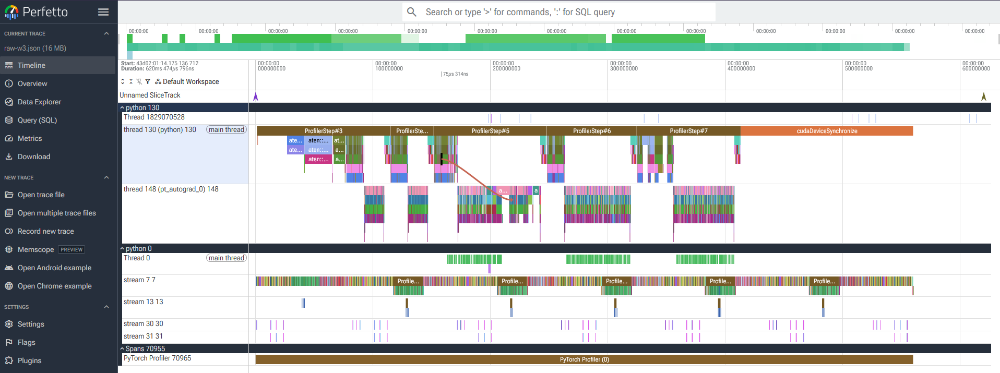

    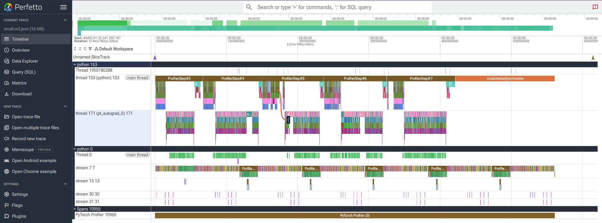

    Les deux traces montrent un profil **limité par le calcul**. Sur la ligne du GPU (`stream 7`), les noyaux s'enchaînent sans trou : le GPU n'attend jamais un batch. Le CPU prend même de l'avance et attend environ 140 ms dans `cudaDeviceSynchronize` à la fin.

    Les tableaux du profiler le confirment : le temps GPU est le même avec raw et small, environ 554 ms, et les convolutions en représentent environ 61 %.

### Question 2.7

- **Avec la meilleure configuration de chargement, quelle fraction du débit synthétique (ref-synth) atteignez-vous ?**

    Avec `raw-w3`, on atteint **99.3 %** du débit synthétique, 710.2 images/s contre 715.0. En fp32, avec 3 workers, c'est donc le calcul qu'il faut maintenant accélérer.

---

## Exercice 3 : Précision mixte, channels_last et torch.compile

> **Note :** J'ai créé `bench_ex3.py` à partir de `bench_ex1.py` en complétant les trous de `setup`. Dans `ex3.sh` et `train.sh`, j'ai ajouté `--account=csc_8607`, et `ex3.sh` appelle `bench_ex3.py`.

### Output du job (`logs/tp6-ex3-54900.out`)

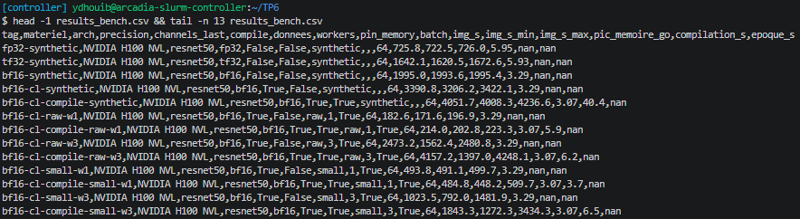

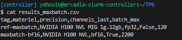

### Output du job (`logs/tp6-train-54905.out`)

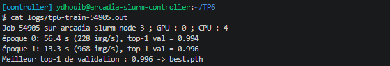

Les deux jobs ont été placés sur un **H100 NVL entier**.

### Question 3.1

- **Présentez les mesures de ex3.sh dans un tableau : configuration, données, débit, pic mémoire, temps de compilation.**

    | Configuration | Données | Débit (images/s) | Pic mémoire (Go) | Compilation (s) |
    | :--- | :--- | :---: | :---: | :---: |
    | fp32 | synthétiques | 725.8 | 5.95 | — |
    | tf32 | synthétiques | 1642.1 | 5.93 | — |
    | bf16 | synthétiques | 1995.0 | 3.29 | — |
    | bf16 + cl | synthétiques | 3390.8 | 3.29 | — |
    | bf16 + cl + compile | synthétiques | **4051.7** | 3.07 | 40.4 |
    | bf16 + cl | raw, 1 worker | 182.6 (171.6 à 196.9) | 3.29 | — |
    | bf16 + cl + compile | raw, 1 worker | 214.0 (202.8 à 223.3) | 3.07 | 5.9 |
    | bf16 + cl | raw, 3 workers | 2473.2 (1562.4 à 2480.8) | 3.29 | — |
    | bf16 + cl + compile | raw, 3 workers | 4157.2 (1397.0 à 4248.1) | 3.07 | 6.2 |
    | bf16 + cl | small, 1 worker | 493.8 (491.1 à 499.7) | 3.29 | — |
    | bf16 + cl + compile | small, 1 worker | 484.8 (448.2 à 509.7) | 3.07 | 3.7 |
    | bf16 + cl | small, 3 workers | 1023.5 (792.0 à 1481.9) | 3.29 | — |
    | bf16 + cl + compile | small, 3 workers | 1843.3 (1272.3 à 3434.3) | 3.07 | 6.5 |

    « cl » désigne `channels_last`. Entre parenthèses, on donne le minimum et le maximum des répétitions.

### Question 3.2

- **Comparez fp32-synthetic à ref-synth de l'exercice 1 : même configuration, deux mesures. Quel écart relatif obtenez-vous ? Qu'en déduisez-vous sur la précision de vos comparaisons ?**

    `fp32-synthetic` donne 725.8 images/s, contre 715.0 pour `ref-synth` sur le même GPU, soit un écart de **1.5 %**.

    -> C'est le bruit de mesure : un écart de 1 à 2 % entre deux configurations n'est pas significatif.

### Question 3.3

- **En données synthétiques, donnez le facteur de gain de chaque étape (TF32, bf16, channels_last, compile) et expliquez-le à l'aide du cours : Tensor Cores, trafic mémoire, fusion.**

    | Étape | Débit (images/s) | Gain de l'étape |
    | :--- | :---: | :---: |
    | fp32 | 725.8 | — |
    | + TF32 | 1642.1 | **×2.26** |
    | + bf16 | 1995.0 | **×1.22** |
    | + channels_last | 3390.8 | **×1.70** |
    | + compile | 4051.7 | **×1.19** |

    *   **TF32 :** les convolutions passent des cœurs CUDA aux **Tensor Cores**.
    *   **bf16 :** les Tensor Cores 16 bits sont deux fois plus rapides, et chaque activation pèse 2 octets au lieu de 4 : **le trafic mémoire est divisé par deux**, comme le pic mémoire, qui passe de 5.93 à 3.29 Go.
    *   **channels_last :** les convolutions 16 bits de cuDNN travaillent en NHWC. En NCHW, il faut transposer les données avant et après chaque convolution : c'est pour cela que le bf16 seul rapporte peu.
    *   **compile :** `torch.compile` **fusionne les opérations élément par élément**, comme la BatchNorm et la ReLU, ce qui évite des allers-retours en mémoire.

    Au total, on gagne **×5.58** par rapport au fp32.

### Question 3.4

- **Pour bf16-cl et bf16-cl-compile, comparez le débit synthétique aux débits raw et small avec 1 et 3 workers. Votre estimation de l'exercice 2 (question 5) le prévoyait-elle ? Où est le goulot dans chaque cas ? Que rapporte compile quand le chargement limite ? Regardez aussi img_s_min et img_s_max : que dit la dispersion des mesures à 1 worker ? Faites le lien avec la loi d'Amdahl.**

    Avec de vraies images, on est **très loin du débit synthétique** de 3390.8 à 4051.7 images/s : avec 1 worker, on n'obtient que 182.6 images/s avec raw et 493.8 avec small.

    **Estimation :** pour 1 worker, l'exercice 2 prévoyait 479 images/s avec small, ce qui correspond bien à la mesure. Avec 3 workers, les médianes sont faussées, comme à l'exercice 2 : `bf16-cl-compile-raw-w3` affiche 4157.2 images/s, bien au-delà des 770 images/s que 3 workers peuvent décoder. Le vrai débit est celui de `train.py` : **968 images/s** avec small.

    **Goulot :** dans tous les cas, c'est **le chargement par le CPU**, et non le GPU.

    **Effet de compile :** il **ne rapporte rien** quand le chargement limite : +17 % avec raw mais -2 % avec small.

    **Dispersion à 1 worker :** avec raw, le débit varie de 171.6 à 196.9 images/s, car il dépend du CPU, partagé avec les autres jobs du nœud.

    **Loi d'Amdahl :** $S = \frac{1}{(1-p) + p/s}$. On n'accélère que la part $p$ du calcul ; si le chargement domine, $p$ est petit, et l'accélération totale reste bloquée près de $\frac{1}{1-p}$.

    -> Une fois le GPU accéléré, c'est le CPU qui limite.

### Question 3.5

- **Un MIG 1g.12gb dispose d'environ 1/7 des multiprocesseurs d'un H100. Sur un H100 entier, combien de workers faudrait-il, en ordre de grandeur, pour alimenter le même entraînement ? Les 30 cœurs d'un nœud arcadia y suffiraient-ils ?**

    Il faudrait environ **9 workers avec small** et **16 avec raw**.

    Sur un H100 entier, le GPU traite 4051.7 images/s en bf16 avec `channels_last` et compile, soit $\frac{4051.7}{479} \approx 8.5$ workers avec small et $\frac{4051.7}{256} \approx 16$ avec raw. En ajoutant le processus principal, **les 30 cœurs d'un nœud suffiraient** pour un seul H100.

### Question 3.6

- **La compilation a lieu cinq fois dans ex3.sh. Comparez les valeurs de compilation_s : que se passe-t-il ? Calculez ensuite le nombre d'itérations nécessaires pour amortir la compilation, avec et sans ce phénomène. Est-ce rentable pour deux époques (2 × 201 pas) ?**

    La première compilation prend **40.4 s**, les suivantes seulement **3.7 à 6.5 s** : `torch.compile` **réutilise son cache sur disque**, et n'a plus qu'à recharger les noyaux déjà compilés.

    Le gain par pas vaut $\frac{64}{3390.8} - \frac{64}{4051.7} \approx 3.08$ ms.
    *   Sans cache : $\frac{40.4}{0.00308} \approx$ **13 100 pas**
    *   Avec cache : $\frac{6}{0.00308} \approx$ **1 950 pas**

    -> Pour deux époques, soit 402 pas, la compilation **n'est pas rentable**, même avec le cache.

### Question 3.7

- **Comparez le batch maximal en bf16 (maxbatch-bf16) à celui en fp32. Le rapport est-il celui que prédit le cours ? Pourquoi ?**

    Sur le H100 entier, le batch maximal passe de **1 128 images en fp32** à **2 200 en bf16**, soit un rapport de **1.95**, proche du facteur 2 du cours.

    En bf16, les activations sont divisées par deux, mais la mémoire statique ne change pas : les poids, gradients et états d'AdamW restent en fp32. Le rapport est donc un peu inférieur à 2.

### Question 3.8

- **Donnez le temps de chaque époque et le top-1 de validation obtenus par train.py. Pourquoi la première époque est-elle plus lente ? Comparez la seconde à ref-raw (exercice 1) : quel facteur d'accélération avez-vous obtenu au total ?**

    | Époque | Temps (s) | Débit (images/s) | Top-1 de validation |
    | :---: | :---: | :---: | :---: |
    | 0 | 56.4 | 228 | 0.994 |
    | 1 | **13.3** | **968** | **0.996** |

    La première époque est plus lente car elle contient **la compilation** du modèle et le démarrage des workers.

    La seconde époque dure 13.3 s contre 18.8 s pour `ref-raw` sur le même GPU, soit une accélération de **×1.41** seulement, alors que le calcul seul a été accéléré de ×5.58.

    -> C'est la loi d'Amdahl en pratique : le chargement des données n'a pas été accéléré, et c'est lui qui limite maintenant l'entraînement.

---

## Exercice 4 : Entraînement multi-GPU avec DDP sous SLURM

> **Note :** Dans `ddp_l4.sh`, j'ai ajouté `--account=csc_8607`.

### Output du job (`logs/tp6-ddp-54909.out`)

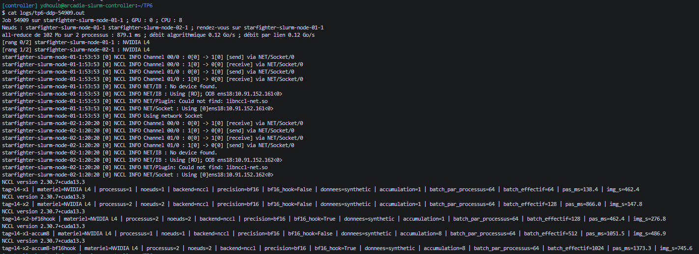

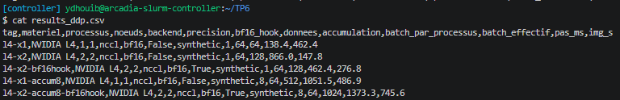

### Question 4.1

- **D'après logs/nccl-<id>.log, quel transport NCCL utilise-t-il entre les deux nœuds ? Donnez la durée de l'all-reduce de 102 Mo et les deux débits affichés. Convertissez le débit en Gbit/s : quel type de lien réseau est-ce ?**

    NCCL utilise le transport **`NET/Socket`**, c'est-à-dire des sockets TCP, car il ne trouve pas d'InfiniBand (`NET/IB : No device found`).

    L'all-reduce de 102 Mo dure **879.1 ms**, avec un débit algorithmique et un débit par lien de **0.12 Go/s**. Cela fait $0.116 \times 8 \approx$ **0.93 Gbit/s** : c'est un lien **Ethernet à 1 Gbit/s**.

### Question 4.2

- **Présentez les six mesures dans un tableau : temps par pas, débit global, accélération $S = D_2/D_1$ (par rapport à la référence à un GPU de même accumulation) et efficacité $E = S/2$.**

    | Mesure | Temps par pas (ms) | Débit (images/s) | $S$ | $E$ |
    | :--- | :---: | :---: | :---: | :---: |
    | `l4-x1` | 138.4 | 462.4 | — | — |
    | `l4-x2` | 866.0 | 147.8 | **0.32** | 0.16 |
    | `l4-x2-bf16hook` | 462.4 | 276.8 | **0.60** | 0.30 |
    | `l4-x1-accum8` | 1051.5 | 486.9 | — | — |
    | `l4-x2-accum8-bf16hook` | 1373.3 | 745.6 | **1.53** | 0.77 |

    Sans accumulation, deux nœuds sont **plus lents** qu'un seul GPU. Seule l'accumulation sur 8 micro-batchs donne une accélération.

### Question 4.3

- **Estimation de la communication : le modèle à 10 classes a 23,5 M paramètres, soit environ 94 Mo de gradients fp32 ; déduisez de la question 1 le temps $t_c$ d'un all-reduce de cette taille ; avec $t_1$ le temps par pas sur un GPU, comparez le temps par pas mesuré sur deux nœuds aux deux cas extrêmes : $t_1 + t_c$ (aucun recouvrement) et $\max(t_1, t_c)$ (recouvrement parfait) ; quelle durée de calcul le recouvrement a-t-il cachée ?**

    Le temps est proportionnel au volume : $t_c \approx 879.1 \times \frac{94}{102} \approx$ **810 ms**. Avec $t_1 = 138.4$ ms :
    *   Aucun recouvrement : $t_1 + t_c \approx 949$ ms
    *   Recouvrement parfait : $\max(t_1, t_c) \approx 810$ ms
    *   Mesure : **866.0 ms**

    Le recouvrement a donc caché $138.4 + 810 - 866.0 \approx$ **83 ms** de calcul, soit à peu près la durée du backward, pendant lequel DDP envoie déjà les premiers gradients.

### Question 4.4

- **Quel est l'effet de --bf16-hook ? Pourquoi ? Quel risque prend-on ?**

    Le hook bf16 fait passer le pas de 866.0 à **462.4 ms**, soit un débit **1.87 fois plus élevé**.

    Il convertit les gradients en bf16 avant l'all-reduce : chaque gradient pèse 2 octets au lieu de 4, donc **le volume envoyé est divisé par deux**. Le risque est une **perte de précision** sur les gradients, car le bf16 n'a que 7 bits de mantisse.

### Question 4.5

- **Pourquoi la loi d'Amdahl ne peut-elle pas décrire ces résultats ? Avec le modèle $T_2 \approx k\,t_1 + t_c - t_{rec}$ ($k$ micro-batchs par pas, $t_{rec}$ la durée recouverte trouvée à la question 3), prédisez le temps par pas de l4-x2-accum8-bf16hook avant de regarder la mesure, puis comparez.**

    La loi d'Amdahl suppose qu'on répartit un travail fixe entre les GPU. Ici, chaque GPU garde son batch de 64 images, et le passage à deux nœuds **ajoute une communication** qui n'existait pas : Amdahl ne peut pas prévoir un ralentissement comme $S = 0.32$.

    Avec $k = 8$, $\frac{t_c}{2} \approx 405$ ms en bf16 et $t_{rec} \approx 83$ ms : $T_2 \approx 8 \times 138.4 + 405 - 83 \approx$ **1 430 ms**. La mesure donne **1373.3 ms**, soit 4 % de moins : un micro-batch sans pas d'optimiseur est un peu plus court que $t_1$.

### Question 4.6

- **À quelle condition le DDP multi-nœuds devient-il rentable sur ce réseau ? Citez deux leviers et leur prix.**

    Le DDP devient rentable quand **le temps de calcul d'un pas dépasse le temps de communication non recouvert**, c'est-à-dire $k\,t_1 > t_c - t_{rec}$.

    *   **Accumulation de gradients :** on ne communique qu'une fois tous les $k$ micro-batchs. Prix : un batch effectif plus grand, donc un taux d'apprentissage à réajuster.
    *   **Compression en bf16 :** on divise par deux le volume envoyé. Prix : une perte de précision sur les gradients.

    -> Sur un réseau à 1 Gbit/s, il faut communiquer rarement : avec le hook bf16, il faut au moins 3 micro-batchs par pas pour que deux nœuds aillent plus vite qu'un seul.

### Question 4.7

- **Le batch effectif atteint 128, puis 1 024 avec l'accumulation. Comment faudrait-il ajuster le taux d'apprentissage pour un vrai entraînement avec AdamW ? Et avec SGD ?**

    Avec **AdamW**, on applique la **règle de la racine carrée** : $\eta = \eta_0 \sqrt{B_{eff}/B_0}$, soit ×1.41 pour 128 et ×4 pour 1 024, avec $B_0 = 64$.

    Avec **SGD**, on applique la **règle linéaire** : $\eta = \eta_0 \cdot B_{eff}/B_0$, soit ×2 pour 128 et ×16 pour 1 024, atteint progressivement par un warm-up.

### Question 4.8

- **Pourquoi tous les processus utilisent-ils la même graine pour l'initialisation, mais des données différentes ? Que se passerait-il si l'on oubliait sampler.set_epoch(epoch) dans la branche small ? Et model.no_sync() dans make_ddp_step ?**

    **Même graine, données différentes :** tous les processus doivent partir **des mêmes poids** pour rester identiques en appliquant le même gradient moyen. Mais chacun doit voir **des images différentes**, sinon les deux GPU calculeraient le même gradient.

    **Sans `sampler.set_epoch(epoch)` :** chaque époque verrait les données **dans le même ordre**.

    **Sans `model.no_sync()` :** DDP lancerait un all-reduce **à chaque micro-batch**. Le résultat resterait correct, mais on paierait 8 communications au lieu d'une, et le gain de l'accumulation disparaîtrait.

---

## Exercice 5 : Quantification int8 sur CPU

> **Note :** Dans `ex5.sh`, j'ai ajouté `--account=csc_8607`.

### Output du job (`logs/tp6-ex5-54912.out`)

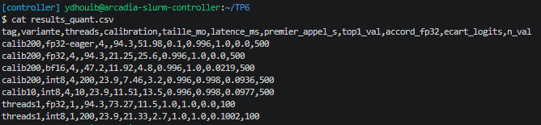

### Question 5.1

- **Présentez les résultats de calib200 dans un tableau : variante, taille (Mo), latence (ms), premier appel (s), top-1.**

    | Variante | Taille (Mo) | Latence (ms) | Premier appel (s) | Top-1 |
    | :--- | :---: | :---: | :---: | :---: |
    | fp32 sans compilation | 94.3 | 51.98 | 0.1 | 0.996 |
    | fp32 compilé | 94.3 | 21.25 | 25.6 | 0.996 |
    | bf16 compilé | 47.2 | 11.92 | 4.8 | 0.996 |
    | int8 compilé | **23.9** | **7.46** | 3.2 | **0.996** |

    Les mesures sont faites sur CPU, avec 4 threads et un batch de 1.

### Question 5.2

- **Le rapport de taille entre fp32 et int8 vaut-il exactement 4 ? Pourquoi ? Lisez weights_mb : pourquoi ne mesure-t-on pas simplement la taille du state_dict du modèle converti ?**

    Le rapport vaut $\frac{94.3}{23.9} \approx$ **3.95**, donc pas exactement 4 : les poids passent en int8, mais les biais et les **échelles de quantification** restent en fp32.

    On ne mesure pas le `state_dict`, car `convert_pt2e` y **garde aussi les poids fp32 d'origine**, que le graphe n'utilise plus : la taille serait surestimée. `weights_mb` ne compte que les tenseurs lus par le graphe.

### Question 5.3

- **Comparez les latences. Pourquoi faut-il comparer l'int8 au fp32 compilé plutôt qu'au fp32 sans compilation ? Le gain de l'int8 est-il en rapport avec les drapeaux CPU relevés à l'exercice 0 (VNNI, AMX) ?**

    L'int8 est **2.85 fois plus rapide** que le fp32 compilé, 7.46 ms contre 21.25 ms.

    La compilation seule accélère déjà le fp32 de ×2.45. Comparer l'int8 au fp32 sans compilation mélangerait donc deux gains : seule la comparaison au fp32 compilé isole l'effet de la quantification.

    Ce gain est cohérent avec les drapeaux du CPU : `avx512_vnni` traite 4 produits int8 par instruction, contre un seul en fp32, soit un gain maximal d'environ 4. Sans **AMX**, il n'y a pas d'unités matricielles pour aller plus loin.

### Question 5.4

- **Quelle perte de précision coûte l'int8 ? Le top-1 suffit-il à juger la quantification sur cette tâche ? Comparez calib200 et calib10 à l'aide de accord_fp32 et ecart_logits : quel est le rôle de la calibration ?**

    L'int8 ne coûte **aucune perte de top-1**, qui reste à 0.996. Seule **une image sur 500** change de prédiction (`accord_fp32` = 0.998).

    Le top-1 **ne suffit pas** : le modèle est presque parfait sur ces 10 classes, et une erreur de plus ne représente que 0.2 %. L'écart des logits est plus sensible : 0.0936 avec 200 images de calibration, contre 0.0977 avec 10 images, pour le même accord de 0.998.

    La calibration sert à **fixer l'échelle des activations** : les observateurs relèvent le minimum et le maximum de chaque activation. Ici, 10 images suffisent presque à estimer ces plages.

### Question 5.5

- **Comparez 1 et 4 threads (threads1). L'accélération est-elle proportionnelle au nombre de threads ? Qu'en déduire pour le déploiement ?**

    L'accélération **n'est pas proportionnelle** : passer de 1 à 4 threads donne ×3.45 en fp32 (73.27 à 21.25 ms) et ×2.86 en int8 (21.33 à 7.46 ms). Avec une seule image, il y a peu de travail à répartir entre les threads.

    -> Pour servir beaucoup de requêtes, il vaut mieux lancer plusieurs instances int8 à 1 thread qu'une seule instance à 4 threads.

### Question 5.6

- **Pourquoi une quantification dynamique serait-elle presque sans effet sur un ResNet ?**

    La quantification dynamique ne s'applique qu'aux **couches linéaires** et récurrentes. Or un ResNet fait presque tout son calcul dans **des convolutions**, et sa seule couche linéaire est la dernière, qui est minuscule.

---

## Rapport final

### Output du script summarize.py

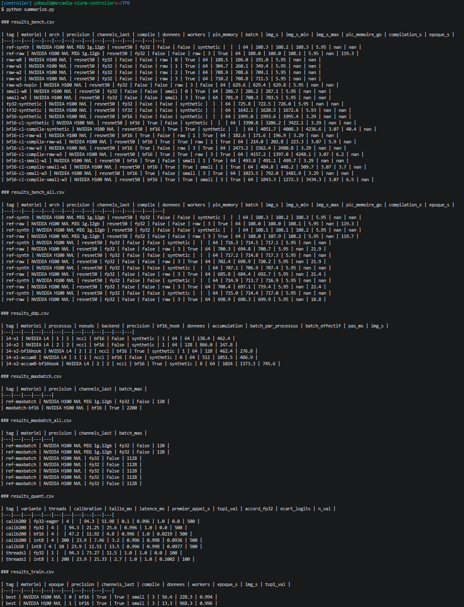

Les fichiers `results_bench_all.csv` et `results_maxbatch_all.csv` gardent tous les runs de l'exercice 1, dont ceux sur H100 NVL entier utilisés comme référence aux exercices 2 et 3.

### Question 1

- **Tableau comparatif de toutes les configurations, de la référence de l'exercice 1 à la meilleure configuration sur un GPU, puis DDP et inférence. Pour chacune : matériel, données, débit, pic mémoire, et temps par époque quand il est mesuré.**

    | Configuration | Matériel | Données | Débit (images/s) | Pic mémoire (Go) | Temps par époque |
    | :--- | :--- | :--- | :---: | :---: | :---: |
    | `ref-synth`, fp32 | H100 MIG 1g.12gb | synthétiques | 108.3 | 5.95 | — |
    | `ref-raw`, fp32 | H100 MIG 1g.12gb | raw, 3 workers | 108.0 | 5.95 | 119.3 s |
    | `ref-raw`, fp32 | H100 NVL entier | raw, 3 workers | 698.9 | 5.95 | 18.8 s |
    | bf16 + cl + compile | H100 NVL entier | synthétiques | 4051.7 | 3.07 | — |
    | `train.py` : bf16 + cl + compile | H100 NVL entier | small, 3 workers | **968** | — | **13.3 s** |
    | `l4-x1` | 1 L4 | synthétiques | 462.4 | — | — |
    | `l4-x2-accum8-bf16hook` | 2 L4 | synthétiques | 745.6 | — | — |
    | Inférence int8 compilé, 4 threads | CPU | 1 image | 134 | 23.9 Mo de poids | — |

### Question 2

- **Analyse des écarts à l'accélération idéale en DDP. Quelle part revient à la communication, au chargement des données, à la synchronisation entre processus ? Appuyez-vous sur vos mesures, pas sur des valeurs générales.**

    Chaque GPU traite le même batch qu'en référence, donc $E = \frac{t_1}{T_2}$ : la perte $1 - E$ est la part du pas qui n'est pas du calcul.

    *   **Communication :** elle explique **presque toute la perte**, avec 84 % du pas sans compression, 70 % avec le hook bf16 et 23 % avec l'accumulation.
    *   **Synchronisation :** elle est **négligeable**, car le modèle $T_2 \approx k\,t_1 + t_c - t_{rec}$, qui l'ignore, retrouve les mesures à 2 ms près.
    *   **Chargement :** il est **nul**, car les données synthétiques sont déjà sur le GPU.

### Question 3

- **Recommandation argumentée : pour entraîner ce modèle sur ce cluster, quelle configuration choisiriez-vous (précision, format mémoire, compilation, chargement, nombre de GPU) et pourquoi ? Pour le déployer sur CPU, quelle variante ?**

    Pour l'entraînement, on choisirait **un seul GPU, en bf16 avec `channels_last`**, qui multiplie le débit par 4.67 et divise la mémoire des activations par deux. On chargerait la copie **small avec 3 workers et `pin_memory`**, car le chargement est le goulot. On n'utiliserait **pas `torch.compile`** pour un entraînement court, car il n'est pas rentable en dessous d'environ 2 000 pas. Le DDP sur deux nœuds n'est pas intéressant ici : même au mieux, il atteint 745.6 images/s, moins qu'un seul H100.

    Pour le déploiement sur CPU, on choisirait **l'int8 compilé** : 4 fois plus petit et 2.85 fois plus rapide que le fp32 compilé, sans perte de top-1.

---
---

*Ce TP nous a permis de mesurer correctement les performances d'un entraînement sur GPU, d'estimer sa mémoire, de trouver le maillon limitant entre le chargement des données et le calcul, d'accélérer le calcul avec bf16, `channels_last` et `torch.compile`, de mesurer le coût de la communication en DDP, et de quantifier le modèle en int8 pour l'inférence sur CPU.*

*Fin*